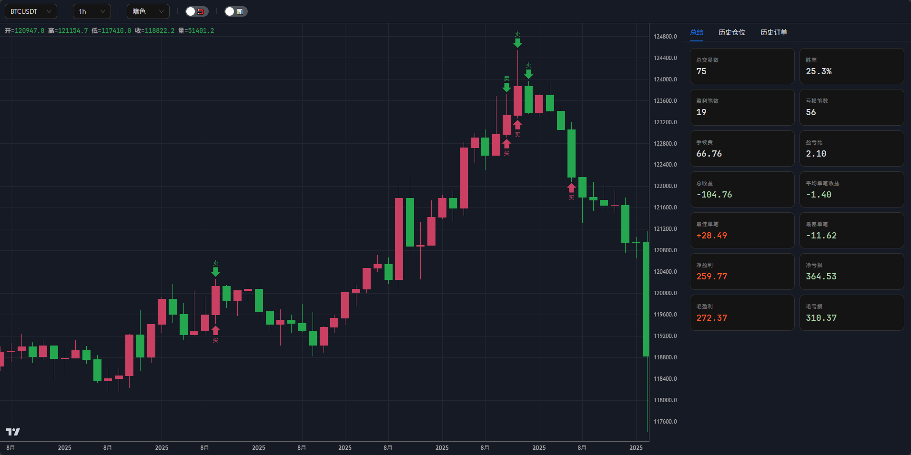

# trading-maid

English | [中文](README.zh-CN.md) 

[](https://crates.io/crates/trading-maid)
[](https://docs.rs/trading-maid)
[](https://github.com/86maid/trading-maid)
[](https://opensource.org/licenses/Apache-2.0)

> ⚡ Keywords: high-fidelity matching / two-stage trigger orders / margin and liquidation mechanics / backtest visualization

trading-maid is a backtesting and live-trading framework for crypto futures, with a strong focus on behavior close to real exchanges.
It includes key mechanics such as matching, slippage, leverage, margin, and liquidation for strategy validation, iteration, and live integration.



## Contents

- [✨ Core Capabilities](#-core-capabilities)
- [🧭 Trading Model and Constraints](#-trading-model-and-constraints)
- [🏗️ Architecture Overview](#-architecture-overview)
- [🚀 Quick Start](#-quick-start)
- [⚡ Fast Backtest](#-fast-backtest)
- [🧠 Context](#-context)
- [📊 Series](#-series)
- [📈 Indicators](#-indicators)
- [🧩 Strategy as Struct](#-strategy-as-struct)
- [🛑 Error Handling](#-error-handling)
- [🚦 Hook Intercept](#-hook-intercept)
- [📊 Custom Series](#-custom-series)
- [🔄 Getting Data at Other Levels](#-getting-data-at-other-levels)
- [🌐 Multi-Asset Strategy](#-multi-asset-strategy)
- [💰 Exchange Account Methods](#-exchange-account-methods)
- [🧰 Utility Functions](#-utility-functions)
- [🧪 EMA Strategy Example](#-ema-strategy-example)
- [📊 Shadow Reversal Example](#-shadow-reversal--candle-wick-reversal-built-in-indicators)
- [📊 Volume Breakout Example](#-volume-breakout--donchian--volume-spike-custom-indicators)
- [📊 Price Action Example](#-price-action--momentum-breakout-custom-indicators)
- [📊 RSI EMA Example](#-rsi-ema--consecutive-candle-breakout-built-in-indicators)
- [📊 Vegas Martingale Example](#-vegas-martingale--vegas-tunnel--rsimacd-built-in-indicators)
- [📊 Horizon Long Example](#-horizon-long--time-series-momentum-custom-indicators)

## ✨ Core Capabilities

- **Backtesting environment close to live trading**: simulates exchange matching logic, with built-in **slippage**, **leverage**, **margin**, and **forced liquidation** mechanics to reduce backtest/live deviation.
- **Live exchange abstraction**: provides a unified exchange interface for smooth migration from backtest to live trading.
- **Indicator and series tools**: includes common technical indicators and time-series processing utilities.
- **Backtest result visualization**: render candlesticks, orders, and position history in a web page.

## 🧭 Trading Model and Constraints

### 🧾 Order Types

- Supported: trigger price + (limit | market)
- Not supported: OCO (take-profit/stop-loss combo order; Binance does not support it either)

### 📦 Position Type

- Margin mode: isolated
- Position direction: one-way
- Margin asset type: single-currency margin
- Margin management: dynamically adjusts position margin

### ⚙️ Order Processing Logic

- **Market order**: fills at `Open` (slippage applied, then clamped to `[Low, High]`).
- **Limit order**:
    - Buy: fills once `Low <= price`, at `min(Open, price)`
    - Sell: fills once `High >= price`, at `max(Open, price)`
    - In other words: if the open is already better than your price, you get the open (price improvement); otherwise you get your price. No slippage.
- **Trigger order**: once the trigger price is touched, it turns into a market or limit order **on the same k-line** and fills by the rules above.
    - The trigger direction is fixed at placement: trigger above the current close → fires when `High >= trigger`; below → fires when `Low <= trigger`.
    - Direction is independent of side: `sell_trigger_market(110.5)` with the market at 105 means "sell once the price rises to 110.5".
    - When it turns into a market order the fill is `max/min(Open, trigger)`: gapped past the trigger → fill at the open; crossed intrabar → fill at the trigger.
- **Timing**: an order placed on a k-line is not matched on that k-line; matching starts on the next one. Only trigger orders can complete "trigger → fill" within the same k-line.
- **Margin freeze**: market orders freeze at fill; limit orders freeze at placement based on their price (any excess is refunded when the fill is better); trigger orders freeze when triggered; reduce-only orders never freeze.
- **Priority**: within a k-line, orders are matched in placement order; pending orders run before liquidation.
- **Fees**: market orders and trigger-to-market use `taker_fee`; limit orders and trigger-to-limit use `maker_fee`; liquidation uses `taker_fee`.

## 🏗️ Architecture Overview

For the full text diagram, see [architecture.txt](architecture.txt).

## 🚀 Quick Start

### 📥 Installation

Using `cargo add`

```bash
cargo add trading-maid
```

Or in `Cargo.toml`

```toml
[dependencies]
trading-maid = "1"
```

### 🛠️ Usage

```rust
use trading_maid::prelude::*;

// Open a short position when a long upper shadow appears.
async fn my_strategy(cx: &Context<'_>) -> anyhow::Result<()> {
    let body_size = (cx.open - cx.close).abs();
    let upper_shadow_size = (cx.high - cx.open).abs();
    let open_short_condition =
        cx.open > cx.close && upper_shadow_size >= body_size * 2 && body_size >= 300;

    if cx.get_position("BTCUSDT").await?.is_none() && open_short_condition {
        println!("place order: {}", t2s(cx.time));

        let take_profit_price = cx.open - upper_shadow_size;
        let stop_price = cx.open + upper_shadow_size;

        cx.cancel_all_order("BTCUSDT").await?;

        _ = cx
            .sell_tp_sl("BTCUSDT", take_profit_price, stop_price, "0.01")
            .await?;
    }

    Ok(())
}

#[tokio::main]
async fn main() {
    // Download the latest 12 months of 1-minute-level data.
    let path = get_or_download("BTCUSDT/1m", 12).await.unwrap();

    let data_source_1m = DataSource::from_file_metadata(
        path,
        Metadata {
            symbol: "BTCUSDT".to_string(),
            level: Level::Minute1,
            min_size: "0.01".parse().unwrap(),
            min_notional: "0".parse().unwrap(),
            tick_size: "0.1".parse().unwrap(),
            maker_fee: "0.0002".parse().unwrap(),
            taker_fee: "0.0005".parse().unwrap(),
            maintenance: "0.004".parse().unwrap(),
        },
    )
    .unwrap();

    let exchange = LocalExchange::new(data_source_1m.clone())
        .unwrap()
        .cash(10000)
        .leverage(10)
        .slippage(0);

    let mut engine = Engine::new(exchange.clone(), my_strategy);

    // Backtest with 1-minute data, but call the strategy whenever each 1-hour k-line is generated.
    if let Err(v) = engine.run("BTCUSDT", Level::Hour1).await {
        println!("error: {:#?}", v);
    }

    let history_position = exchange.get_history_position_list("BTCUSDT").await.unwrap();
    let history_order = exchange.get_history_order_list("BTCUSDT").await.unwrap();
    let summary = summarize(&history_position);

    println!("history summary: {:#?}", summary);

    // Resample 1-minute data into 1-hour data.
    let data_source_1h = data_source_1m.resample(Level::Hour1).unwrap();

    // Pass multiple time levels for easier switching in the visualization.
    open_in_server(
        [data_source_1h, data_source_1m],
        history_position,
        history_order,
    )
    .await
    .unwrap();
}
```

In this example, we set:

* minimum order size (min_size): 0.01
* minimum notional (min_notional): 0.0 = no restriction
* price tick size (tick_size): 0.1
* maker fee (maker_fee): 0.0002
* taker fee (taker_fee): 0.0005
* maintenance margin rate (maintenance): 0.004
* cash: 10000
* leverage: 10
* slippage: 0

**The backtest runs on 1-minute data while the strategy runs on 1-hour k-lines.** The engine calls the strategy at each 1-hour k-line close (the last minute of each hour), and every k-line observed by the strategy is 1-hour-level.

Although other levels can be used, you should **always use 1-minute data as the backtest source** to achieve high-precision results.

`open_in_server` starts a local server and automatically opens the backtest visualization page in the browser. 

Prefer `open_in_server` over `open_in_browser` — the latter writes k-line data to a file each time, causing the browser to reload and wasting time.

Use `cargo run -r` to run backtests faster.

> ⚠️ Note: `sell_tp_sl` is syntactic sugar, not a real OCO order (OCO is not supported by the framework). It simply places two orders at once — you still need to call `cancel_all_order` to cancel old orders before opening a new position.

> ⚠️ **Stop Loss**: Stop loss should use trigger orders. For example, after a market buy, use `sell_trigger_market_reduce_only` (trigger price reached → reduce-only market sell); after a market sell, use `buy_trigger_market_reduce_only` (trigger price reached → reduce-only market buy). Do NOT use `sell_limit_reduce_only` or `buy_limit_reduce_only` — in an order book, a sell limit below market (or buy limit above market) crosses the spread and matches instantly, turning your stop loss into an immediate market exit instead of waiting for the price to reach your stop. Simply put, your limit order fills instantly at the market price. Also, always use `reduce_only` — without it, the order may open a reverse position instead of closing your current one.

> ⚠️ **Precision Warning**: When creating orders (e.g., `buy`, `sell`, `buy_limit`, `sell_tp_sl`, etc.), price and quantity parameters accept `impl TryInto<Decimal>`. To avoid floating-point precision loss, pass high-precision values as strings (e.g., `"0.01"`) instead of `f64` literals like `0.01`.

## ⚡ Fast Backtest

For quick backtesting with sensible defaults, use the `backtest()` function — it handles data downloading, exchange setup, and engine creation automatically. One function call is all you need:

```rust
use trading_maid::prelude::*;

// Open a short position when a long upper shadow appears.
async fn my_strategy(cx: &Context<'_>) -> anyhow::Result<()> {
    let body_size = (cx.open - cx.close).abs();
    let upper_shadow_size = (cx.high - cx.open).abs();
    let open_short_condition =
        cx.open > cx.close && upper_shadow_size >= body_size * 2 && body_size >= 300;

    if cx.get_position("BTCUSDT").await?.is_none() && open_short_condition {
        println!("place order: {}", t2s(cx.time));

        let take_profit_price = cx.open - upper_shadow_size;
        let stop_price = cx.open + upper_shadow_size;

        cx.cancel_all_order("BTCUSDT").await?;

        _ = cx
            .sell_tp_sl("BTCUSDT", take_profit_price, stop_price, "0.01")
            .await?;
    }

    Ok(())
}

#[tokio::main]
async fn main() {
    let result = backtest("BTCUSDT", 12, my_strategy, Level::Hour1)
        .await
        .unwrap();

    // Backtest result summary
    println!("summary: {:#?}", result.summarize());

    // Visualization with data resampled to all compatible levels
    result.resample_all_open_in_server().await.unwrap();
}
```

`backtest()` uses the following preset configurations:

* **Data source**: 1-minute level (auto-downloaded via `get_or_download`)
* **Metadata**: min_size=0.01, min_notional=0, tick_size=0.1, maker_fee=0.0002, taker_fee=0.0005, maintenance=0.004
* **Exchange**: cash=1,000,000, leverage=1, slippage=0

### BacktestResult API

The returned `BacktestResult` provides:

| Method | Description |
|--------|-------------|
| `summarize()` | Returns a `HistoryPositionSummary` with key metrics (win rate, profit/loss, total trades, etc.) |
| `open_in_browser()` | Writes visualization to a temp HTML file and opens it in the default browser |
| `open_in_server()` | Starts a local server for visualization at the strategy level |
| `resample_all_open_in_server()` | Starts a local server with data resampled to all compatible levels for easy switching |

> 💡 **This is the lazy approach** — perfect for rapid strategy prototyping and quick experiments. For full control over fees, leverage, slippage, cash, and other parameters, use the manual setup shown in [Quick Start](#-quick-start).

## 🧠 Context

In `Context`, `time`, `open`, `high`, `low`, and `close` are of type `&Series`, which is essentially a wrapped slice.

You can use `cx.close[0]` for the current k-line close, `cx.close[1]` for the previous k-line close, and so on.

You can use `&cx.close[2..]` to get a slice.

This type also overloads many operators, so you can omit index `[0]` in calculations, for example `cx.close + 100`.

You can destructure `Context` for easier OHLCV usage.

```rust
async fn my_strategy(
    Context {
        time,
        open,
        high,
        low,
        close,
        volume,
        exchange,
        series,
    }: &Context<'_>,
) -> anyhow::Result<()> {
    println!("time: {}", t2s(time));
    Ok(())
}
```

### 🕳️ Gap Detection: `cx.missed`

K-lines can be lost — a websocket reconnect, a stalled process, or an archive that simply never published a bar. The engine skips the hole and reports it through `cx.missed`, which is `None` on a normal bar and otherwise tells you **which kind** of hole it was:

```rust
pub enum Missed {
    /// The bars exist but the strategy was not called: `close[1]`, `close[2]`, ...,
    /// `close[n]` are them, in order. The series stays continuous.
    Backfilled(usize),
    /// The bars do not exist: `time` jumps, and `close[1..=n]` cannot be read.
    Missing(usize),
}
```

In both variants `n` means the same thing: this call covers `n + 1` strategy periods instead of one.

**`Backfilled`** — a live exchange dropped bars and the engine recovered them through `get_kline`. The values are in the series, so a stateful strategy can replay them and stay exact:

```rust
match cx.missed {
    Some(Missed::Backfilled(n)) => {
        for i in (1..=n).rev() {
            self.ema_cache.update(cx.close[i]);
        }
    }
    _ => {}
}
```

**`Missing`** — the bars are not in the data at all (a hole in a historical archive). There is nothing to replay: `close[1]` belongs to the bar before the hole, and an out-of-range index returns the `Decimal::MAX` sentinel, which would poison any indicator. The only correct response is to reset the incremental state:

```rust
if let Some(Missed::Missing(_)) = cx.missed {
    self.ema_cache = EMACache::new(self.length);
}
```

A strategy that ignores `cx.missed` is only correct while it is `None` — either handle both variants, or rebuild from the full history with `EMACache::from_series`.

Two more things worth knowing:

- Any strategy-level bar whose source bars were affected by a hole is **dropped whole**, never delivered with a partial volume/high/low that still looks perfectly contiguous. That is why `Missing` always agrees with a jump in `cx.time`.
- `cx.request(...)` exposes the same field for the symbol it returns.

Real archives do have such holes. **Binance's futures archive is missing 2026-10-28 entirely**:
the monthly `BTCUSDT-1m-2026-10.zip` holds 43200 rows instead of the 44640 a 31-day month should
have, the 1h file is short by 24 bars, and the daily `2026-10-28.zip` returns 404 — while the
**spot archive for that day is complete**. Nothing is ever filled in: a 12/24/36/48-month futures
backtest simply skips that day, the strategy-level bars it covers are dropped whole, and the next
call reports `Missed::Missing(n)`.

## 📊 Series

`Series` is the core numeric type used throughout `Context`. It wraps a reversed slice — `series[0]` is the current bar, `series[1]` the previous, and so on. Out-of-bounds indices return `Decimal::MAX`.

`Series` overloads a wide range of operators, so you can write natural expressions:

```rust
// Arithmetic — omits [0] automatically
cx.close + 100;
cx.high - cx.low;
cx.close * dec!(1.5);

// Comparison — compare directly with numbers or strings
cx.close == 123;
cx.close > 123.456;
cx.close < "0.0005";

// Slicing — returns &Series
&cx.close[2..];     // from 2 bars ago to the start
&cx.close[..5];     // most recent 5 bars
&cx.close[2..5];    // range of bars
```

> ⚠️ **Precision Warning:** Avoid `f64` literals — use strings (`"123.456"`) or the `dec!` macro instead to prevent floating-point precision loss.

## 📈 Indicators

Some commonly used indicators are built into `indicator`.

```rust
async fn my_strategy(cx: &Context<'_>) -> anyhow::Result<()> {
    highest(cx.high, 7);
    sma(cx.close, 30);
    ema(cx.close, 144);
    Ok(())
}
```

Calling `ema` directly may lead to slow backtests and incorrect calculations, because EMA depends on the previous EMA value. So it is recommended to use `EMACache` for fast and accurate calculation.

Use `EMACache::with_ema` to create an instance with an initial EMA value, then call `EMACache::update` on each k-line to update and get the current value:

When the data does not start from the very first k-line (live trading, a preloaded window, or a narrower backtest range), rebuild the cache from history with `EMACache::from_series(cx.close, 144)` instead of hard-coding a number.

```rust
async fn next(&mut self, cx: &Context) -> anyhow::Result<()> {
    let Some(ema144) = self.ema_cache144.update(cx.close) else {
        return Ok(());
    };
    
    Ok(())
}
```

## 🧩 Strategy as Struct

When your strategy needs to maintain state (e.g., caches, counters), implement the `Strategy` trait on a struct.

```rust
struct MyStrategy {
    ema_cache: EMACache,
    count: usize,
}

#[async_trait(?Send)]
impl Strategy for MyStrategy {
    async fn next(&mut self, cx: &Context) -> anyhow::Result<()> {
        // use self.ema_cache, self.count ...
        Ok(())
    }
}

let mut engine = Engine::new(exchange.clone(), MyStrategy::new());
```

## 🛑 Error Handling

Use `on_error` to handle errors returned by the strategy. If not set, the engine stops immediately when an error occurs.

```rust
let mut engine = Engine::new(exchange.clone(), MyStrategy::new());

engine.on_error(|err| {
    eprintln!("strategy error: {:#?}", err);
    Ok(()) // return Ok to continue, or Err to stop the engine
});

if let Err(v) = engine.run("BTCUSDT", Level::Hour1).await {
    println!("{:#?}", v);
}
```

> 💡 Unlike `hook` which runs on every k-line, `on_error` is only called when the strategy returns an error.

## 🚦 Hook Intercept

You can use `hook` to stop backtesting when a position is liquidated or an order is rejected (insufficient balance).

The hook function is called after the strategy executes on each k-line. Its second argument carries the k-lines that had to be backfilled after a network interruption (empty on a normal bar), so the hook's own state can catch up.

```rust
async fn my_hook(_: KLine, _: &[KLine], exchange: ExchangeWrapper) -> anyhow::Result<()> {
    if let Some(v) = exchange
        .get_history_order_list("BTCUSDT")
        .await?
        .iter()
        .find(|v| v.status == Status::Rejected || v.kind == Kind::Liquidation)
    {
        anyhow::bail!(
            "rejected/liquidation {}: cash: {}",
            t2s(v.update_time),
            exchange.get_cash().await?
        );
    }

    Ok(())
}

let mut engine = Engine::new(exchange.clone(), MyStrategy::new());

engine.hook(my_hook);

if let Err(v) = engine.run("BTCUSDT", Level::Minute5).await {
    println!("{:#?}", v);
}
```

## 📊 Custom Series

Use `add_series` to attach custom data (funding rate, on-chain metrics, sentiment, etc.) to the engine. Once registered, the series is synchronised with the OHLCV data and accessible in the strategy via `cx["name"]`.

### Aligning Custom Data

Custom data usually comes as sparse `(timestamp_ms, value)` pairs. Use `align_to_series` to forward-fill these into an `AlignedSeries` at a target k-line level:

```rust
// Sparse custom data: (timestamp_ms, value)
let custom_data = vec![
    (1717200000000, "1.5".parse::<Decimal>().unwrap()),
    (1717286400000, "2.3".parse::<Decimal>().unwrap()),
];

// Forward-fill align to 1-hour bars
let series = align_to_series(&custom_data, Level::Hour1).unwrap();

// Register with the engine before calling run()
let mut engine = Engine::new(exchange, my_strategy);
engine.add_series("BTCUSDT", "custom_metric", series);
engine.run("BTCUSDT", Level::Hour1).await?;
```

### Funding Rate Example

`get_or_download_funding_rate_to_series` downloads Binance funding rate history and aligns it automatically:

```rust
let funding_rate_series = get_or_download_funding_rate_to_series(
    "BTCUSDT", 12, Level::Hour1,
).await.unwrap();

engine.add_series("BTCUSDT", "funding_rate", funding_rate_series);
engine.run("BTCUSDT", Level::Hour1).await?;
```

### Access in Strategy

Read the additional series by name inside the strategy:

```rust
async fn my_strategy(cx: &Context<'_>) -> anyhow::Result<()> {
    if cx["funding_rate"] != &[] {
        // Current bar's funding rate
        let fr = cx["funding_rate"][0];
        // Previous bar
        let fr_prev = cx["funding_rate"][1];

        // Avoid longing when funding is too high
        if fr > "0.0005" {
            return Ok(());
        }
    }

    Ok(())
}
```

If no series is registered for the given symbol/level/name, `cx[name]` returns an empty series (compare with `== []`).

## 🔄 Getting Data at Other Levels

Use `cx.request()` to obtain a symbol's OHLCV context at a **specific level**.

```rust
// Get BTCUSDT at 5-minute level
if let Some(btc_5m_cx) = cx.request("BTCUSDT", Level::Minute5) {
    let sma_30 = sma(btc_5m_cx.close, 30);
}
```

`request` is powered by **resampling**:

- If the requested level matches the **strategy level** (the level passed to `engine.run`) or the **source data level** (the DataSource's level), pre-built data is returned instantly with zero overhead.
- For any other level, the framework resamples from the source kline data to the target level. The result is **computed on first access and cached** — subsequent calls within the same bar hit the cache and incur no extra cost.

The target interval must be an integer multiple of the source data interval. Use `is_valid_sampling_target` to check compatibility.
Monthly bars are the exception: their length follows the calendar (28–31 days), so they are only generated from source levels whose interval divides one day (1m–12h, 1d). Aggregating 3d or 1w bars into a month would assign a bar that straddles the month boundary entirely to the earlier month, so it is rejected.

> ⚠️ **Recommendation: always use 1‑minute data as the source.** This allows resampling to any coarser level for maximum flexibility.

## 🌐 Multi-Asset Strategy

Run a strategy across multiple symbols simultaneously. Pass an array of symbols to `run()` and use `cx.request()` to access other symbols' OHLCV data:

```rust
let exchange = LocalExchange::new([btc_data, eth_data])?;

let mut engine = Engine::new(exchange, my_strategy);

// Pass multiple symbols to run()
engine.run(["BTCUSDT", "ETHUSDT"], Level::Hour1).await?;
```

In the strategy, access another symbol's context via `cx.request()`:

```rust
async fn my_strategy(cx: &Context<'_>) -> anyhow::Result<()> {
    // Access BTCUSDT directly (primary symbol)
    let sma_val = sma(cx.close, 30);

    // Access ETHUSDT via request
    if let Some(eth_cx) = cx.request("ETHUSDT", Level::Hour1) {
        // Use eth_cx like a normal Context
        let sma_val = sma(eth_cx.close, 30);
    }
    
    Ok(())
}
```

> ⚠️ **Note:** All symbols must share the same level, and their data time ranges must overlap — the strategy only fires when all symbols have data at the current bar.
>
> ⚠️ **Note:** The engine calls `next` concurrently for each symbol.

## 💰 Exchange Account Methods

### Querying Account State

```rust
async fn my_strategy(cx: &Context<'_>) -> anyhow::Result<()> {
    // Total equity = cash + unrealized PnL of all positions.
    let equity = cx.get_equity().await?;

    // Available cash balance.
    let cash = cx.get_cash().await?;

    // Leverage currently configured for the symbol.
    let leverage = cx.get_leverage("BTCUSDT").await?;

    println!("equity: {}, cash: {}, leverage: {}x", equity, cash, leverage);

    Ok(())
}
```

> 💡 `get_equity` counts **unrealized** PnL, so it moves with price on every bar, while `get_cash` only reflects realized changes. `equity - cash` is therefore a quick read on open position performance.

### Adjusting Leverage

`set_leverage` changes the leverage **and immediately re-computes the position margin** from the open average price and quantity. Raising leverage frees margin back to cash; lowering it requires extra cash.

```rust
// Set the leverage for the symbol to 20x.
cx.set_leverage("BTCUSDT", 20).await?;
```

Because margin is recalculated, `set_leverage` can fail. Handle those errors rather than unwrapping:

- **Pending orders block the call**: if the symbol has any open order, the leverage cannot be changed. Cancel them first with `cx.cancel_all_order(symbol).await?`.
- **Insufficient cash**: lowering leverage increases the required margin; if `cash` cannot cover the shortfall, the call fails and the position is left untouched.

### Adjusting Position Margin to Avoid Liquidation

`append_position_margin` adds margin to an existing position. Extra margin pushes the **liquidation price further away** from the current price, which is the standard way to rescue a position that is drifting toward forced liquidation.

Where the liquidation price sits before opening a position can be predicted with `calc_liquidation_price`, which takes the leverage, the maintenance margin rate from the symbol metadata, the position side, entry price, quantity, and total position margin:

```rust
let metadata = cx.get_metadata("BTCUSDT").await?;

let liquidation_price = calc_liquidation_price(
    20,                            // leverage
    metadata.maintenance,          // maintenance margin rate
    Side::Buy,
    "60000".parse().unwrap(),      // entry price
    "0.5".parse().unwrap(),        // quantity
    "1500".parse().unwrap(),       // total position margin
);
```

So for a long, adding margin **lowers** the liquidation price (safer); for a short, adding margin **raises** it. Passing a negative `margin` withdraws margin and tightens the liquidation price.

```rust
// Add 500 to the position margin, moving the liquidation price further away.
cx.append_position_margin("BTCUSDT", "500").await?;

// Withdraw 500 back to cash, moving the liquidation price closer.
cx.append_position_margin("BTCUSDT", "-500").await?;
```

Guard rails to be aware of:

- **Margin cannot be reduced below the initial margin** of the position (`entry_price * quantity / leverage`); attempting it fails with the minimum required margin in the message.

### Detecting Liquidation

In the position history, `is_liquidation()` tells whether a position was force-closed:

```rust
async fn my_strategy(cx: &Context<'_>) -> anyhow::Result<()> {
    if let Some(last) = cx.get_history_position_list("BTCUSDT").await?.last()
        && last.is_liquidation()
    {
        anyhow::bail!("position was liquidated at {}", t2s(last.close_time));
    }

    Ok(())
}
```

### 🛫 Preloading History (Live Only)

A freshly started live strategy is blind until its indicators have seen enough bars — `sma(cx.close, 200)` returns `None` for the first 200 bars. Preloading pulls history before the first live k-line so the strategy is usable immediately:

```rust
// Take the last 200 bars before the first live k-line.
engine.preload(200);

// ...or everything from this timestamp onward (0 = as early as the exchange allows).
engine.preload_from(1735689600000);

// ...or seed from data you already hold in memory.
engine.preload_data(data_source);
```

Only one setting applies; the last call wins. Preloading is ignored in backtests, where the data source already starts from its first bar.

The preloaded range ends **exactly one bar before** the first live k-line, so `cx` stays contiguous and never duplicates that bar. If the gap between the seed and the first live bar cannot be filled through `get_kline`, the engine aborts rather than starting with a hole.

Preloading fills `cx`, not your own state: an `EMACache` still starts from zero unless you seed it with `EMACache::from_series(cx.close, 144)` on the first call.

## 🧰 Utility Functions

```rust
use trading_maid::prelude::*;

// Convert a Unix timestamp in milliseconds to a local-time string.
t2s(1717200000000u64);

// Convert a Unix timestamp in milliseconds to a UTC string.
t2s_utc(1717200000000u64);

// Convert a local-time string back to a Unix timestamp in milliseconds.
s2t("2024/06/01 04:00:00");

// Convert a UTC string back to a Unix timestamp in milliseconds.
s2t_utc("2024/06/01 04:00:00");

// Get the start of the current bar and the start of the next bar.
get_time_range(1717200000000, Level::Hour1)?;

// Get the end time of the coarser bar that contains the given time.
get_last_time(1717200000000, Level::Minute1, Level::Hour1)?;

// Round a price to the nearest valid tick size.
round_to_tick(dec!(60000.37), dec!(0.1));

// Check whether a price is aligned to the tick size.
is_tick_aligned("60000.4".parse().unwrap(), "0.1".parse().unwrap());

// Calculate the initial margin: price * quantity / leverage.
calc_initial_margin("60000".parse().unwrap(), "0.5".parse().unwrap(), 20);

// Calculate the liquidation price for a position.
calc_liquidation_price(20, "0.004".parse().unwrap(), Side::Buy, "60000".parse().unwrap(), "0.5".parse().unwrap(), "1500".parse().unwrap());

// Forward-fill sparse (timestamp, value) pairs onto a k-line level.
align_to_series(&[(1717200000000u64, "1.5".parse().unwrap())], Level::Hour1)?;

// Resample a list of k-lines to a coarser level.
resample(&kline_list, Level::Hour1)?;

// Resample a data file into every coarser level, writing each next to it.
resample_file("BTCUSDT-1m.csv")?;

// Download k-line data, or reuse the local cache if present.
get_or_download("BTCUSDT/1m", 12).await?;

// Download funding rate history.
get_or_download_funding_rate("BTCUSDT", 12).await?;

// Download funding rate history and align it to a k-line level.
get_or_download_funding_rate_to_series("BTCUSDT", 12, Level::Hour8).await?;

// Render data sources, positions and orders into an HTML string.
to_html(&data_source_list, &history_position_list, &history_order_list);

// Render into a temp HTML file and open it in the browser.
open_in_browser(&data_source_list, &history_position_list, &history_order_list)?;

// Serve the rendered result from a local web server and open it.
open_in_server(data_source_list, history_position_list, history_order_list).await?;

// Aggregate a list of closed positions into summary statistics.
summarize(&history_position_list);
```

## 📐 Strategy Examples

### 🧪 demo_indicator — EMA example

The smallest runnable example, showing how to use a built-in indicator (`EMACache`): go short when the last 50 bars closed below the EMA and the current bar closes above it.
The two hard-coded EMA seed values only exist so the example can produce an indicator from its very first bar; they go stale as soon as the data range changes — use `EMACache::from_series` in a real strategy.

```rust
use trading_maid::prelude::*;

struct MyStrategy {
    ema_cache144: EMACache,
    ema_cache169: EMACache,
    count: usize,
}

impl MyStrategy {
    pub fn new() -> Self {
        // 80871 / 78705 是从某个日期那根 5m K 线算出来的 EMA 值，写死只是为了让示例从第一根
        // bar 就能算出指标。换数据区间、换起始日期，这两个数就失效了；实盘或换区间时应该改用
        // EMACache::from_series(cx.close, 144) 从历史重建。
        MyStrategy {
            ema_cache144: EMACache::with_ema(144, 80871),
            ema_cache169: EMACache::with_ema(169, 78705),
            count: 0,
        }
    }
}

#[async_trait(?Send)]
impl Strategy for MyStrategy {
    // 如果连续 50 根 K 线收盘价都在 EMA 之下，且当前 K 线收盘价突破 EMA，则开空单
    async fn next(&mut self, cx: &Context) -> anyhow::Result<()> {
        let Some(ema144) = self.ema_cache144.update(cx.close) else {
            return Ok(());
        };

        let Some(ema169) = self.ema_cache169.update(cx.close) else {
            return Ok(());
        };

        if self.count >= 50
            && (cx.close >= ema144 || cx.close >= ema169)
            && cx.get_position("BTCUSDT").await?.is_none()
        {
            println!("place_order: {}", t2s(cx.time));

            cx.cancel_all_order("BTCUSDT").await?;

            _ = cx
                .sell_tp_sl("BTCUSDT", cx.close - 1000, cx.close + 1000, "0.01")
                .await?;
        }

        if cx.close <= ema144 && cx.close <= ema169 {
            self.count += 1;
        } else {
            self.count = 0;
        }

        Ok(())
    }
}

async fn my_hook(_: KLine, _: &[KLine], exchange: ExchangeWrapper) -> anyhow::Result<()> {
    if let Some(v) = exchange
        .get_history_order_list("BTCUSDT")
        .await?
        .iter()
        .find(|v| v.status == Status::Rejected || v.kind == Kind::Liquidation)
    {
        anyhow::bail!(
            "rejected/liquidation {}: cash: {}",
            t2s(v.update_time),
            exchange.get_cash().await?
        );
    }

    Ok(())
}

#[tokio::main]
async fn main() {
    let path = get_or_download("BTCUSDT/1m", 12).await.unwrap();

    let data_source_1m = DataSource::from_file_metadata(
        path,
        Metadata {
            symbol: "BTCUSDT".to_string(),
            level: Level::Minute1,
            min_size: "0.01".parse().unwrap(),
            min_notional: "0".parse().unwrap(),
            tick_size: "0.1".parse().unwrap(),
            maker_fee: "0.0002".parse().unwrap(),
            taker_fee: "0.0005".parse().unwrap(),
            maintenance: "0.004".parse().unwrap(),
        },
    )
    .unwrap();

    let exchange = LocalExchange::new(data_source_1m.clone())
        .unwrap()
        .cash(10000)
        .leverage(10)
        .slippage(0);

    let mut engine = Engine::new(exchange.clone(), MyStrategy::new());

    engine.hook(my_hook);

    if let Err(v) = engine.run("BTCUSDT", Level::Minute5).await {
        println!("error: {:#?}", v);
    }

    let history_position = exchange.get_history_position_list("BTCUSDT").await.unwrap();
    let history_order = exchange.get_history_order_list("BTCUSDT").await.unwrap();
    let summary = summarize(&history_position);

    println!("history summary: {:#?}", summary);

    let data_source_5m = data_source_1m.resample(Level::Minute5).unwrap();
    let data_source_1h = data_source_1m.resample(Level::Hour1).unwrap();

    open_in_server(
        [data_source_5m, data_source_1m, data_source_1h],
        history_position,
        history_order,
    )
    .await
    .unwrap();
}
```

### 📦 demo_minimal

Go short on a long upper wick and attach take-profit/stop — the least code that runs end to end.

```rust
use trading_maid::prelude::*;

// 出现长上影线时开空单
async fn my_strategy(cx: &Context<'_>) -> anyhow::Result<()> {
    let body_size = (cx.open - cx.close).abs();
    let upper_shadow_size = (cx.high - cx.open).abs();
    let open_short_condition =
        cx.open > cx.close && upper_shadow_size >= body_size * 2 && body_size >= 300;

    if cx.get_position("BTCUSDT").await?.is_none() && open_short_condition {
        println!("place order: {}", t2s(cx.time));

        let take_profit_price = cx.open - upper_shadow_size;
        let stop_price = cx.open + upper_shadow_size;

        cx.cancel_all_order("BTCUSDT").await?;

        _ = cx
            .sell_tp_sl("BTCUSDT", take_profit_price, stop_price, "0.01")
            .await?;
    }

    Ok(())
}

#[tokio::main]
async fn main() {
    let path = get_or_download("BTCUSDT/1m", 12).await.unwrap();

    let data_source_1m = DataSource::from_file_metadata(
        path,
        Metadata {
            symbol: "BTCUSDT".to_string(),
            level: Level::Minute1,
            min_size: "0.01".parse().unwrap(),
            min_notional: "0".parse().unwrap(),
            tick_size: "0.1".parse().unwrap(),
            maker_fee: "0.0002".parse().unwrap(),
            taker_fee: "0.0005".parse().unwrap(),
            maintenance: "0.004".parse().unwrap(),
        },
    )
    .unwrap();

    let exchange = LocalExchange::new(data_source_1m.clone())
        .unwrap()
        .cash(10000)
        .leverage(10)
        .slippage(0);

    let mut engine = Engine::new(exchange.clone(), my_strategy);

    // 使用 1 分钟级别数据进行回测，但在每个 1 小时级别的 K 线生成时都会调用策略函数
    if let Err(v) = engine.run("BTCUSDT", Level::Hour1).await {
        println!("error: {:#?}", v);
    }

    let history_position = exchange.get_history_position_list("BTCUSDT").await.unwrap();
    let history_order = exchange.get_history_order_list("BTCUSDT").await.unwrap();
    let summary = summarize(&history_position);

    println!("history summary: {:#?}", summary);

    // 从 1 分钟级别数据重采样得到 1 小时级别数据
    let data_source_1h = data_source_1m.resample(Level::Hour1).unwrap();

    open_in_server(
        [data_source_1h, data_source_1m],
        history_position,
        history_order,
    )
    .await
    .unwrap();
}
```

### 💰 demo_funding_rate

Download the funding rate as a custom series and go long when five consecutive periods are negative — shows `add_series` and `cx["funding_rate"]`.

```rust
use trading_maid::prelude::*;

// 资金费率为负的时候做多
async fn my_strategy(cx: &Context<'_>) -> anyhow::Result<()> {
    let funding_rate = &cx["funding_rate"];

    if funding_rate != &[] {
        if cx.get_position("BTCUSDT").await?.is_none()
            && funding_rate < 0
            && funding_rate[1] < 0
            && funding_rate[2] < 0
            && funding_rate[3] < 0
            && funding_rate[4] < 0
        {
            println!(
                "place order: {}, funding_rate: {}",
                t2s(cx.time),
                funding_rate
            );

            let take_profit_price = cx.open + 1000;
            let stop_price = cx.open - 1000;

            cx.cancel_all_order("BTCUSDT").await?;

            _ = cx
                .buy_tp_sl("BTCUSDT", take_profit_price, stop_price, "0.01")
                .await?;
        }
    }

    Ok(())
}

#[tokio::main]
async fn main() {
    let path = get_or_download("BTCUSDT/1m", 12).await.unwrap();

    let data_source_1m = DataSource::from_file_metadata(
        path,
        Metadata {
            symbol: "BTCUSDT".to_string(),
            level: Level::Minute1,
            min_size: "0.01".parse().unwrap(),
            min_notional: "0".parse().unwrap(),
            tick_size: "0.1".parse().unwrap(),
            maker_fee: "0.0002".parse().unwrap(),
            taker_fee: "0.0005".parse().unwrap(),
            maintenance: "0.004".parse().unwrap(),
        },
    )
    .unwrap();

    let exchange = LocalExchange::new(data_source_1m.clone())
        .unwrap()
        .cash(10000)
        .leverage(10)
        .slippage(0);

    let mut engine = Engine::new(exchange.clone(), my_strategy);

    engine.add_series(
        "BTCUSDT",
        "funding_rate",
        get_or_download_funding_rate_to_series("BTCUSDT", 12, Level::Hour8)
            .await
            .unwrap(),
    );

    if let Err(v) = engine.run("BTCUSDT", Level::Hour8).await {
        println!("error: {:#?}", v);
    }

    let history_position = exchange.get_history_position_list("BTCUSDT").await.unwrap();
    let history_order = exchange.get_history_order_list("BTCUSDT").await.unwrap();
    let summary = summarize(&history_position);

    println!("history summary: {:#?}", summary);

    let data_source_4h = data_source_1m.resample(Level::Hour4).unwrap();
    let data_source_1h = data_source_1m.resample(Level::Hour1).unwrap();

    open_in_server(
        [data_source_4h, data_source_1h, data_source_1m],
        history_position,
        history_order,
    )
    .await
    .unwrap();
}
```

## 🏆 Strategy Leaderboard

Every `strategy_*` file under `examples/` is a complete strategy — entry/exit rules, position sizing, a full backtest. The complete source lives in the file of the same name; the leaderboard below is what that code produces.

Same setup for every row: BTCUSDT futures, 1m source data, starting cash 1,000,000, position size
set by each strategy (mostly 0.01 BTC). The absolute numbers are therefore tiny — **read the
ordering, PF and drawdown, not a percentage return**. The 2026-10-28 archive hole is skipped.

Every window runs **the same code with parameters untouched**. 3 and 6 months are far too small to
mean anything; judge robustness from 12 months upwards.

### 3 months (2026-08 to 2026-10)

| # | Strategy | Trades | Win | PF | Net profit | Max DD | Profit/DD |
|--:|---|--:|--:|--:|--:|--:|--:|
| 1 | `strategy_horizon_long` | 15 | 20% | 1.79 | **+405.78** | 233.51 | 1.74 |
| 2 | `strategy_volume_breakout` | 8 | 62.5% | 2.37 | +108.46 | 57.20 | 1.90 |
| 3 | `strategy_rsi_ema` | 16 | 43.8% | 1.49 | +74.27 | 138.88 | 0.53 |
| 4 | `strategy_fast` | 4 | 50% | 2.31 | +13.52 | 10.35 | 1.31 |
| 5 | `strategy_pullback_continuation` | 5 | 40% | 1.29 | +11.84 | 29.30 | 0.40 |
| 6 | `strategy_vegas_martingale` | 0 | 0% | — | 0.00 | 0.00 | — |
| 7 | `strategy_price_action` | 8 | 25% | 0.76 | -25.51 | 86.04 | -0.30 |
| 8 | `strategy_shadow_reversal` | 8 | 12.5% | 0.22 | -89.76 | 89.76 | -1.00 |
| 9 | `strategy_squeeze_dual_structure` | 14 | 14.3% | 0.41 | -108.57 | 139.42 | -0.78 |
| 10 | `strategy_dual_structure_trend` | 14 | 14.3% | 0.41 | -108.57 | 139.42 | -0.78 |
| 11 | `strategy_pullback_plus_breakout` | 14 | 14.3% | 0.41 | -108.57 | 139.42 | -0.78 |
| 12 | `strategy_pullback_trend` (baseline) | 11 | 9.1% | 0.24 | -114.93 | 114.93 | -1.00 |
| 13 | `strategy_fib_martingale` | 10 | 30% | 0.29 | -117.38 | 129.05 | -0.91 |
| 14 | `strategy_fib_martingale_050` | 14 | 42.9% | 0.32 | -136.26 | 162.67 | -0.84 |
| 15 | `strategy_fib_martingale_1h_050` | 63 | 44.4% | 0.65 | -141.22 | 155.79 | -0.91 |
| 16 | `strategy_fib_martingale_1h` | 61 | 31.1% | 0.55 | -175.26 | 175.26 | -1.00 |

### 6 months (2026-05 to 2026-10)

| # | Strategy | Trades | Win | PF | Net profit | Max DD | Profit/DD |
|--:|---|--:|--:|--:|--:|--:|--:|
| 1 | `strategy_horizon_long` | 30 | 30% | 1.36 | **+309.43** | 233.51 | 1.33 |
| 2 | `strategy_volume_breakout` | 26 | 42.3% | 1.26 | +83.66 | 200.44 | 0.42 |
| 3 | `strategy_rsi_ema` | 37 | 35.1% | 1.09 | +34.27 | 195.81 | 0.18 |
| 4 | `strategy_fast` | 6 | 33.3% | 0.79 | -6.41 | 30.28 | -0.21 |
| 5 | `strategy_pullback_continuation` | 13 | 46.2% | 0.92 | -8.38 | 54.08 | -0.15 |
| 6 | `strategy_pullback_plus_breakout` | 24 | 33.3% | 0.9 | -26.45 | 139.42 | -0.19 |
| 7 | `strategy_dual_structure_trend` | 24 | 33.3% | 0.87 | -34.14 | 139.42 | -0.24 |
| 8 | `strategy_pullback_trend` (baseline) | 17 | 17.6% | 0.75 | -47.48 | 137.87 | -0.34 |
| 9 | `strategy_vegas_martingale` | 12 | 25% | 0.45 | -48.34 | 48.34 | -1.00 |
| 10 | `strategy_squeeze_dual_structure` | 24 | 33.3% | 0.77 | -63.74 | 139.42 | -0.46 |
| 11 | `strategy_fib_martingale` | 23 | 47.8% | 0.72 | -64.76 | 174.35 | -0.37 |
| 12 | `strategy_price_action` | 24 | 25% | 0.73 | -77.26 | 117.60 | -0.66 |
| 13 | `strategy_fib_martingale_050` | 27 | 51.9% | 0.52 | -148.03 | 227.59 | -0.65 |
| 14 | `strategy_shadow_reversal` | 18 | 11.1% | 0.31 | -180.00 | 180.00 | -1.00 |
| 15 | `strategy_fib_martingale_1h` | 105 | 38.1% | 0.65 | -227.78 | 316.21 | -0.72 |
| 16 | `strategy_fib_martingale_1h_050` | 113 | 46% | 0.61 | -290.49 | 369.26 | -0.79 |

### 12 months (2025-11 to 2026-10)

| # | Strategy | Trades | Win | PF | Net profit | Max DD | Profit/DD |
|--:|---|--:|--:|--:|--:|--:|--:|
| 1 | `strategy_dual_structure_trend` | 72 | 44.4% | 1.5 | **+290.98** | 139.42 | 2.09 |
| 2 | `strategy_pullback_plus_breakout` | 72 | 43.1% | 1.48 | +269.81 | 139.42 | 1.94 |
| 3 | `strategy_pullback_continuation` | 34 | 55.9% | 2.35 | +264.37 | 54.08 | 4.89 |
| 4 | `strategy_squeeze_dual_structure` | 70 | 45.7% | 1.43 | +252.15 | 139.42 | 1.81 |
| 5 | `strategy_shadow_reversal` | 48 | 35.4% | 1.43 | +237.75 | 192.31 | 1.24 |
| 6 | `strategy_volume_breakout` | 43 | 44.2% | 1.26 | +175.88 | 203.38 | 0.86 |
| 7 | `strategy_rsi_ema` | 83 | 36.1% | 1.13 | +138.43 | 282.45 | 0.49 |
| 8 | `strategy_fib_martingale_050` | 59 | 59.3% | 1.16 | +93.95 | 227.59 | 0.41 |
| 9 | `strategy_pullback_trend` (baseline) | 51 | 35.3% | 1.13 | +57.93 | 137.87 | 0.42 |
| 10 | `strategy_horizon_long` | 65 | 30.8% | 1.03 | +56.64 | 527.07 | 0.11 |
| 11 | `strategy_price_action` | 62 | 32.3% | 1.06 | +48.83 | 227.77 | 0.21 |
| 12 | `strategy_vegas_martingale` | 16 | 37.5% | 1.16 | +18.82 | 39.80 | 0.47 |
| 13 | `strategy_fib_martingale` | 51 | 49% | 1.02 | +8.57 | 174.35 | 0.05 |
| 14 | `strategy_fast` | 45 | 28.9% | 0.86 | -30.56 | 81.68 | -0.37 |
| 15 | `strategy_fib_martingale_1h_050` | 228 | 50.9% | 0.92 | -120.90 | 384.13 | -0.31 |
| 16 | `strategy_fib_martingale_1h` | 205 | 41.5% | 0.8 | -281.74 | 420.85 | -0.67 |

### 24 months (2024-11 to 2026-10)

| # | Strategy | Trades | Win | PF | Net profit | Max DD | Profit/DD |
|--:|---|--:|--:|--:|--:|--:|--:|
| 1 | `strategy_horizon_long` | 137 | 32.1% | 1.14 | **+694.60** | 1443.24 | 0.48 |
| 2 | `strategy_squeeze_dual_structure` | 151 | 49.7% | 1.35 | +520.11 | 143.62 | 3.62 |
| 3 | `strategy_rsi_ema` | 133 | 41.4% | 1.2 | +446.97 | 552.36 | 0.81 |
| 4 | `strategy_dual_structure_trend` | 145 | 47.6% | 1.31 | +428.09 | 222.27 | 1.93 |
| 5 | `strategy_volume_breakout` | 107 | 46.7% | 1.2 | +427.26 | 469.23 | 0.91 |
| 6 | `strategy_pullback_plus_breakout` | 140 | 46.4% | 1.27 | +368.90 | 226.36 | 1.63 |
| 7 | `strategy_pullback_continuation` | 70 | 57.1% | 1.64 | +333.83 | 72.11 | 4.63 |
| 8 | `strategy_price_action` | 128 | 37.5% | 1.17 | +324.21 | 311.34 | 1.04 |
| 9 | `strategy_shadow_reversal` | 110 | 31.8% | 1.19 | +288.99 | 291.36 | 0.99 |
| 10 | `strategy_pullback_trend` (baseline) | 100 | 40% | 1.24 | +259.44 | 242.99 | 1.07 |
| 11 | `strategy_fib_martingale` | 101 | 49.5% | 1.15 | +200.89 | 298.88 | 0.67 |
| 12 | `strategy_fib_martingale_1h_050` | 437 | 51.5% | 1.01 | +43.09 | 442.83 | 0.10 |
| 13 | `strategy_vegas_martingale` | 32 | 34.4% | 1 | -0.84 | 98.47 | -0.01 |
| 14 | `strategy_fast` | 156 | 27.6% | 0.84 | -128.71 | 181.64 | -0.71 |
| 15 | `strategy_fib_martingale_050` | 115 | 52.2% | 0.92 | -148.81 | 456.00 | -0.33 |
| 16 | `strategy_fib_martingale_1h` | 398 | 43.5% | 0.88 | -370.32 | 462.94 | -0.80 |

### 36 months (2023-11 to 2026-10)

| # | Strategy | Trades | Win | PF | Net profit | Max DD | Profit/DD |
|--:|---|--:|--:|--:|--:|--:|--:|
| 1 | `strategy_horizon_long` | 190 | 33.7% | 1.21 | **+1426.04** | 1284.60 | 1.11 |
| 2 | `strategy_squeeze_dual_structure` | 245 | 49.4% | 1.35 | +770.79 | 143.62 | 5.37 |
| 3 | `strategy_dual_structure_trend` | 239 | 47.7% | 1.31 | +653.87 | 222.27 | 2.94 |
| 4 | `strategy_volume_breakout` | 168 | 48.2% | 1.2 | +622.18 | 469.23 | 1.33 |
| 5 | `strategy_pullback_plus_breakout` | 233 | 45.5% | 1.27 | +559.84 | 226.36 | 2.47 |
| 6 | `strategy_pullback_trend` (baseline) | 147 | 40.8% | 1.23 | +342.25 | 242.99 | 1.41 |
| 7 | `strategy_pullback_continuation` | 119 | 52.9% | 1.31 | +278.20 | 150.89 | 1.84 |
| 8 | `strategy_fib_martingale` | 143 | 51% | 1.15 | +272.65 | 298.88 | 0.91 |
| 9 | `strategy_price_action` | 195 | 37.4% | 1.1 | +264.46 | 311.34 | 0.85 |
| 10 | `strategy_rsi_ema` | 106 | 41.5% | 1.1 | +184.43 | 348.64 | 0.53 |
| 11 | `strategy_vegas_martingale` | 37 | 37.8% | 1.51 | +127.36 | 82.87 | 1.54 |
| 12 | `strategy_shadow_reversal` | 150 | 30% | 1.05 | +104.73 | 291.36 | 0.36 |
| 13 | `strategy_fib_martingale_050` | 166 | 53.6% | 0.92 | -205.49 | 488.56 | -0.42 |
| 14 | `strategy_fast` | 192 | 26% | 0.78 | -215.16 | 239.02 | -0.90 |
| 15 | `strategy_fib_martingale_1h_050` | 637 | 51.6% | 0.93 | -347.93 | 610.32 | -0.57 |
| 16 | `strategy_fib_martingale_1h` | 623 | 45.3% | 0.87 | -552.29 | 702.10 | -0.79 |

### 48 months (2022-11 to 2026-10)

| # | Strategy | Trades | Win | PF | Net profit | Max DD | Profit/DD |
|--:|---|--:|--:|--:|--:|--:|--:|
| 1 | `strategy_horizon_long` | 263 | 31.9% | 1.22 | **+1724.22** | 1284.60 | 1.34 |
| 2 | `strategy_squeeze_dual_structure` | 327 | 47.7% | 1.37 | +892.28 | 143.62 | 6.21 |
| 3 | `strategy_dual_structure_trend` | 318 | 46.2% | 1.32 | +754.43 | 222.27 | 3.39 |
| 4 | `strategy_pullback_plus_breakout` | 312 | 44.2% | 1.28 | +656.30 | 226.36 | 2.90 |
| 5 | `strategy_volume_breakout` | 199 | 48.2% | 1.18 | +609.75 | 469.23 | 1.30 |
| 6 | `strategy_pullback_trend` (baseline) | 210 | 40% | 1.25 | +419.08 | 242.99 | 1.72 |
| 7 | `strategy_price_action` | 242 | 38.8% | 1.13 | +375.82 | 311.34 | 1.21 |
| 8 | `strategy_pullback_continuation` | 144 | 53.5% | 1.33 | +322.38 | 150.89 | 2.14 |
| 9 | `strategy_fib_martingale` | 193 | 48.2% | 1.11 | +240.38 | 298.88 | 0.80 |
| 10 | `strategy_vegas_martingale` | 51 | 41.2% | 1.56 | +154.67 | 82.87 | 1.87 |
| 11 | `strategy_rsi_ema` | 158 | 39.2% | 1.05 | +107.92 | 348.64 | 0.31 |
| 12 | `strategy_shadow_reversal` | 151 | 29.8% | 1.05 | +94.93 | 291.36 | 0.33 |
| 13 | `strategy_fast` | 194 | 25.8% | 0.76 | -248.63 | 272.49 | -0.91 |
| 14 | `strategy_fib_martingale_050` | 209 | 51.2% | 0.9 | -286.13 | 553.67 | -0.52 |
| 15 | `strategy_fib_martingale_1h_050` | 832 | 51.7% | 0.93 | -381.15 | 610.32 | -0.62 |
| 16 | `strategy_fib_martingale_1h` | 805 | 45.1% | 0.87 | -617.50 | 702.10 | -0.88 |

### 60 months (2021-11 to 2026-10)

| # | Strategy | Trades | Win | PF | Net profit | Max DD | Profit/DD |
|--:|---|--:|--:|--:|--:|--:|--:|
| 1 | `strategy_horizon_long` | 330 | 31.2% | 1.1 | **+982.43** | 1284.60 | 0.76 |
| 2 | `strategy_volume_breakout` | 239 | 49% | 1.23 | +898.28 | 469.23 | 1.91 |
| 3 | `strategy_squeeze_dual_structure` | 406 | 47.3% | 1.28 | +810.78 | 199.98 | 4.05 |
| 4 | `strategy_dual_structure_trend` | 397 | 45.1% | 1.24 | +660.77 | 222.27 | 2.97 |
| 5 | `strategy_price_action` | 313 | 38.7% | 1.17 | +565.66 | 311.34 | 1.82 |
| 6 | `strategy_pullback_plus_breakout` | 391 | 42.7% | 1.2 | +541.44 | 226.36 | 2.39 |
| 7 | `strategy_rsi_ema` | 363 | 37.5% | 1.12 | +501.29 | 536.13 | 0.94 |
| 8 | `strategy_fib_martingale` | 235 | 48.9% | 1.13 | +328.98 | 298.88 | 1.10 |
| 9 | `strategy_pullback_trend` (baseline) | 261 | 37.5% | 1.15 | +300.54 | 242.99 | 1.24 |
| 10 | `strategy_pullback_continuation` | 184 | 52.2% | 1.22 | +256.47 | 150.89 | 1.70 |
| 11 | `strategy_vegas_martingale` | 69 | 34.8% | 1.28 | +101.73 | 84.83 | 1.20 |
| 12 | `strategy_shadow_reversal` | 174 | 30.5% | 1.03 | +79.01 | 291.36 | 0.27 |
| 13 | `strategy_fast` | 182 | 26.9% | 0.82 | -168.41 | 194.32 | -0.87 |
| 14 | `strategy_fib_martingale_050` | 259 | 52.1% | 0.94 | -176.81 | 670.84 | -0.26 |
| 15 | `strategy_fib_martingale_1h_050` | 1039 | 52.6% | 0.97 | -203.10 | 717.52 | -0.28 |
| 16 | `strategy_fib_martingale_1h` | 1039 | 46.1% | 0.89 | -594.61 | 702.10 | -0.85 |

### 72 months (2020-11 to 2026-10)

| # | Strategy | Trades | Win | PF | Net profit | Max DD | Profit/DD |
|--:|---|--:|--:|--:|--:|--:|--:|
| 1 | `strategy_horizon_long` | 398 | 31.2% | 1.26 | **+3017.09** | 1284.60 | 2.35 |
| 2 | `strategy_squeeze_dual_structure` | 488 | 48.2% | 1.34 | +1223.25 | 199.98 | 6.12 |
| 3 | `strategy_dual_structure_trend` | 474 | 46.2% | 1.29 | +1029.30 | 222.27 | 4.63 |
| 4 | `strategy_volume_breakout` | 294 | 49% | 1.19 | +959.34 | 469.23 | 2.04 |
| 5 | `strategy_pullback_plus_breakout` | 467 | 44.1% | 1.27 | +931.40 | 226.36 | 4.11 |
| 6 | `strategy_rsi_ema` | 420 | 38.3% | 1.18 | +903.11 | 514.77 | 1.75 |
| 7 | `strategy_price_action` | 379 | 38.8% | 1.16 | +680.64 | 311.34 | 2.19 |
| 8 | `strategy_pullback_continuation` | 230 | 53.9% | 1.35 | +546.27 | 205.99 | 2.65 |
| 9 | `strategy_fib_martingale` | 279 | 48.4% | 1.15 | +440.55 | 298.88 | 1.47 |
| 10 | `strategy_pullback_trend` (baseline) | 305 | 37% | 1.12 | +307.47 | 242.99 | 1.27 |
| 11 | `strategy_vegas_martingale` | 76 | 34.2% | 1.29 | +127.03 | 104.85 | 1.21 |
| 12 | `strategy_fib_martingale_050` | 303 | 52.5% | 0.95 | -183.62 | 670.84 | -0.27 |
| 13 | `strategy_shadow_reversal` | 228 | 28.9% | 0.9 | -311.41 | 637.37 | -0.49 |
| 14 | `strategy_fib_martingale_1h_050` | 1244 | 52.6% | 0.94 | -425.04 | 730.11 | -0.58 |
| 15 | `strategy_fib_martingale_1h` | 1203 | 46.6% | 0.93 | -453.10 | 781.00 | -0.58 |
| 16 | `strategy_fast` | 159 | 27% | 0.57 | -506.33 | 544.00 | -0.93 |


### Observations

1. **Short windows (3/6 months) carry almost no information**: at 3 months only 4 of 16 strategies are positive, at 6 months only 3. Yet `horizon_long` tops both (+405 / +309) — its profit is highly concentrated in the recent stretch, which is not the same as being reliable.
2. **`squeeze_dual_structure` is the steadiest over time**: positive in all six windows from 12 months up, profit/DD 1.81 / 3.62 / 5.37 / 6.21 / 4.05 / 6.12, with drawdown pinned between 143 and 200 — the only strategy whose risk does not grow as the window lengthens.
3. **`horizon_long` earns the most but is wildly unstable**: +3017.09 over 72 months (first place), yet only +982.43 over 60 months — less than the +1724.22 it makes over 48. The extra twelve months were a net loss, so it lives off a few trending stretches. Its 1284 drawdown is the largest in the table.
4. **`pullback_continuation` owns the short windows**: +264.37 at 12 months with a profit/DD of 4.89 (best in the table), dropping to 1.70 / 2.65 at 60/72 months — its edge is concentrated in the last two years.
5. **`fib_martingale` barely works even on 4h**: the 4h version makes +440.55 over 72 months; the 1h variants lose in every long window (PF 0.89–0.97) and the `_050` variant turns negative after 24 months. The more often they add, the more they lose.
6. **`fast` and `shadow_reversal` fall apart on long windows**: `fast` slides from −30 to −506 (PF 0.57), and `shadow_reversal` goes negative (−311.41) at 72 months. Their 12-month showing was regime luck.
