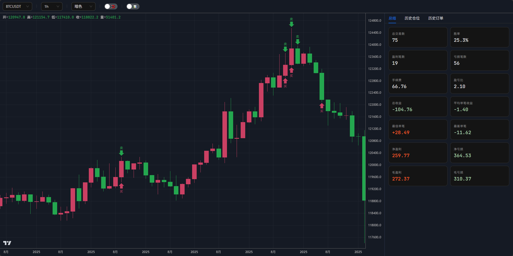

# trading-maid

[English](README.md)  | 中文

[](https://crates.io/crates/trading-maid)
[](https://docs.rs/trading-maid)
[](https://github.com/86maid/trading-maid)
[](https://opensource.org/licenses/Apache-2.0)

> ⚡ 关键词：高拟真撮合 / 双阶段触发单 / 保证金与强平机制 / 回测可视化

trading-maid 是一个面向加密货币合约交易的回测与实盘框架，重点是尽量贴近真实交易环境。

框架内置撮合、滑点、杠杆、保证金与强平等关键机制，可用于策略验证、迭代和实盘接入。



## 目录

- [✨ 核心能力](#-核心能力)
- [🧭 交易模型与限制](#-交易模型与限制)
- [🏗️ 架构概览](#-架构概览)
- [🚀 快速开始](#-快速开始)
- [⚡ 快速回测](#-快速回测)
- [🧠 Context](#-context)
- [📊 Series](#-series)
- [📈 指标](#-指标)
- [🧩 策略 Struct](#-策略-struct)
- [🛑 错误处理](#-错误处理)
- [🚦 Hook 劫持](#-hook-劫持)
- [📊 自定义系列](#-自定义系列)
- [🔄 获取其他级别的数据](#-获取其他级别的数据)
- [🌐 多币种策略](#-多币种策略)
- [💰 交易所账户方法](#-交易所账户方法)
- [🧰 常用工具函数](#-常用工具函数)
- [🧪 EMA 策略例子](#-ema-策略例子)
- [📊 影线反转策略](#-影线反转策略--candle-wick-reversal使用内置指标)
- [📊 成交量突破策略](#-成交量突破策略--donchian--volume-spike自实现指标)
- [📊 动量突破策略](#-动量突破策略--price-action自实现指标)
- [📊 RSI EMA 突破策略](#-rsi-ema-突破策略--consecutive-candle-breakout使用内置指标)
- [📊 Vegas 马丁格尔策略](#-vegas-马丁格尔策略--vegas-tunnel--rsimacd使用内置指标)
- [📊 时序动量做多策略](#-时序动量做多策略--time-series-momentum自实现指标)

## ✨ 核心能力

- **贴近实盘的回测环境**：模拟交易所撮合逻辑，内置**滑点**、**杠杆**、**保证金**与**强制平仓**机制，降低回测与实盘偏差。
- **实盘接口抽象**：支持统一的交易所接口，便于从回测迁移到实盘。
- **指标与序列工具**：提供常用技术指标与时间序列处理能力。
- **回测结果可视化**：可将 K 线、订单与持仓历史以网页形式展示。

## 🧭 交易模型与限制

### 🧾 订单类型

- 支持：触发价 + (限价 | 市价)
- 不支持：OCO（止盈止损组合单，币安也不支持）

### 📦 仓位类型

- 保证金模式：逐仓
- 持仓方向：单向持仓
- 保证金类型：单币种保证金
- 保证金管理：动态调整仓位保证金

### ⚙️ 订单处理逻辑

- **市价单**：以 `Open` 成交（套滑点后夹取到 `[Low, High]`）。
- **委托单**：
    - 买入：`Low <= 委托价` 即成交，成交价 `min(Open, 委托价)`
    - 卖出：`High >= 委托价` 即成交，成交价 `max(Open, 委托价)`
    - 即：开盘价已优于委托价 → 按开盘价成交（价格改善）；否则 → 按委托价成交。不吃滑点。
- **触发单**：触发价被触及后，在**同一根 K 线内**转成市价单或委托单，按上面两种规则成交。
    - 触发方向在挂单时定死：触发价在当前收盘价**上方** → `High >= 触发价` 才触发；**下方** → `Low <= 触发价` 才触发。
    - 方向与买卖无关：`sell_trigger_market(110.5)` 挂在市场价 105 上方，是“涨到 110.5 才卖”。
    - 转市价时成交价取 `max/min(Open, 触发价)`：跳空越过触发价 → 按开盘价；盘中穿越 → 按触发价。
- **时序**：下单当根不撮合，从下一根开始；只有触发单能在同一根内完成“触发 → 成交”。
- **保证金冻结**：市价单成交时冻结；委托单下单时按委托价冻结，成交价更优时退还差额；触发单在触发时才冻结；只减仓不冻结。
- **优先级**：同一根内按挂单顺序撮合，挂单先于强平。
- **手续费**：市价单、触发转市价用 `taker_fee`；委托单、触发转委托用 `maker_fee`；强平用 `taker_fee`。

## 🏗️ 架构概览

完整文字架构图见 [architecture.txt](architecture.txt)。

## 🚀 快速开始

### 📥 安装

使用 `cargo add`

```bash
cargo add trading-maid
```

或者 `Cargo.toml`

```toml
[dependencies]
trading-maid = "1"
```

### 🛠️ 使用

```rust
use trading_maid::prelude::*;

// 出现长上影线时开空单
async fn my_strategy(cx: &Context<'_>) -> anyhow::Result<()> {
    let body_size = (cx.open - cx.close).abs();
    let upper_shadow_size = (cx.high - cx.open).abs();
    let open_short_condition =
        cx.open > cx.close && upper_shadow_size >= body_size * 2 && body_size >= 300;

    if cx.get_position("BTCUSDT").await?.is_none() && open_short_condition {
        println!("place order: {}", t2s(cx.time));

        let take_profit_price = cx.open - upper_shadow_size;
        let stop_price = cx.open + upper_shadow_size;

        cx.cancel_all_order("BTCUSDT").await?;

        _ = cx
            .sell_tp_sl("BTCUSDT", take_profit_price, stop_price, "0.01")
            .await?;
    }

    Ok(())
}

#[tokio::main]
async fn main() {
    // 下载最近 12 个月的 1 分钟级别数据
    let path = get_or_download("BTCUSDT/1m", 12).await.unwrap();

    let data_source_1m = DataSource::from_file_metadata(
        path,
        Metadata {
            symbol: "BTCUSDT".to_string(),
            level: Level::Minute1,
            min_size: "0.01".parse().unwrap(),
            min_notional: "0".parse().unwrap(),
            tick_size: "0.1".parse().unwrap(),
            maker_fee: "0.0002".parse().unwrap(),
            taker_fee: "0.0005".parse().unwrap(),
            maintenance: "0.004".parse().unwrap(),
        },
    )
    .unwrap();

    let exchange = LocalExchange::new(data_source_1m.clone())
        .unwrap()
        .cash(10000)
        .leverage(10)
        .slippage(0);

    let mut engine = Engine::new(exchange.clone(), my_strategy);

    // 使用 1 分钟级别数据进行回测，但在每个 1 小时级别的 K 线生成时都会调用策略函数
    if let Err(v) = engine.run("BTCUSDT", Level::Hour1).await {
        println!("error: {:#?}", v);
    }

    let history_position = exchange.get_history_position_list("BTCUSDT").await.unwrap();
    let history_order = exchange.get_history_order_list("BTCUSDT").await.unwrap();
    let summary = summarize(&history_position);

    println!("history summary: {:#?}", summary);

    // 从 1 分钟级别数据重采样得到 1 小时级别数据
    let data_source_1h = data_source_1m.resample(Level::Hour1).unwrap();

    // 传入多个时间级别，方便在可视化页面中切换查看。
    open_in_server(
        [data_source_1h, data_source_1m],
        history_position,
        history_order,
    )
    .await
    .unwrap();
}
```

在这个例子中，我们设置了

* 最小下单数量 (min_size) 0.01
* 最小名义价值 (min_notional) 0.0 = 无限制
* 价格变化精度 (tick_size) 0.1
* 挂单费率 (maker_fee) 0.0002
* 吃单费率 (taker_fee) 0.0005
* 维持保证金率 (maintenance) 0.004
* 现金 (cash)  = 10000  
* 杠杆 (leverage) = 10  
* 滑点 (slippage) = 0

**回测为 1 分钟级别，策略为 1 小时级别**，回测引擎会在 1 小时级别的 k 线收盘时（一小时的最后一分钟）调用策略，策略获取到的每一根 k 线都是 1 小时级别的。

虽然可以使用其他级别，但是应 **始终使用 1 分钟级别的数据进行回测**，这样可以获得高精度的结果。

`open_in_server` 会启动一个本地服务器并自动在浏览器中打开回测可视化页面。

推荐优先使用 `open_in_server` 而非 `open_in_browser`，后者会每次都把 K 线数据写入文件导致浏览器重新加载，浪费时间。

使用 `cargo run -r` 能更快的完成回测。

> ⚠️ 注意：`sell_tp_sl` 只是语法糖，并非真正的 OCO 订单（框架不支持 OCO），它仅仅是同时下了两张单，需要你自己在开新仓前调用 `cancel_all_order` 来取消旧单。

> ⚠️ **止损注意**：止损应该使用触发单，例如，市价做多后的止损应使用 `sell_trigger_market_reduce_only`（价格到达触发价后执行只减仓市价卖出），市价做空后的止损应使用 `buy_trigger_market_reduce_only`（价格到达触发价后执行只减仓市价买入）。不要用 `sell_limit_reduce_only` 或 `buy_limit_reduce_only`——在订单簿中，卖出限价低于市价（或买入限价高于市价）意味着你的挂单直接穿过了买卖价差，会立刻成交，止损单就变成了即时市价出场，而不是等价格跌到止损位再触发。简单说，你的限价单会立即以市价成交。此外，止损务必使用 `reduce_only`，否则可能导致仓位反向持仓。

> ⚠️ **精度警告**：创建订单时（如 `buy`、`sell`、`buy_limit`、`sell_tp_sl` 等），价格和数量参数接受 `impl TryInto<Decimal>`。为避免浮点数精度丢失，对于高精度的数值，应使用字符串形式传入（如 `"0.01"`），而不是使用 `f64` 字面量如 `0.01`。

## ⚡ 快速回测

如果你想要用合理的预设配置快速回测，可以使用 `backtest()` 函数——它会自动处理数据下载、交易所设置和引擎创建，一行代码搞定：

```rust
use trading_maid::prelude::*;

// 出现长上影线时开空单
async fn my_strategy(cx: &Context<'_>) -> anyhow::Result<()> {
    let body_size = (cx.open - cx.close).abs();
    let upper_shadow_size = (cx.high - cx.open).abs();
    let open_short_condition =
        cx.open > cx.close && upper_shadow_size >= body_size * 2 && body_size >= 300;

    if cx.get_position("BTCUSDT").await?.is_none() && open_short_condition {
        println!("place order: {}", t2s(cx.time));

        let take_profit_price = cx.open - upper_shadow_size;
        let stop_price = cx.open + upper_shadow_size;

        cx.cancel_all_order("BTCUSDT").await?;

        _ = cx
            .sell_tp_sl("BTCUSDT", take_profit_price, stop_price, "0.01")
            .await?;
    }

    Ok(())
}

#[tokio::main]
async fn main() {
    let result = backtest("BTCUSDT", 12, my_strategy, Level::Hour1)
        .await
        .unwrap();

    // 回测结果汇总
    println!("summary: {:#?}", result.summarize());

    // 数据重采样到所有级别后可视化
    result.resample_all_open_in_server().await.unwrap();
}
```

`backtest()` 使用以下预设配置：

* **数据源**：1 分钟级别（自动通过 `get_or_download` 下载）
* **Metadata**：min_size=0.01、min_notional=0、tick_size=0.1、maker_fee=0.0002、taker_fee=0.0005、maintenance=0.004
* **交易所**：cash=1,000,000、leverage=1、slippage=0

### BacktestResult API

返回的 `BacktestResult` 提供以下方法：

| 方法 | 说明 |
|--------|-------------|
| `summarize()` | 返回 `HistoryPositionSummary`，包含胜率、盈亏、总交易次数等关键指标 |
| `open_in_browser()` | 将可视化写入临时 HTML 文件并在默认浏览器中打开 |
| `open_in_server()` | 启动本地服务器，以策略级别数据进行可视化 |
| `resample_all_open_in_server()` | 启动本地服务器，数据重采样到所有兼容级别，方便切换查看 |

> 💡 **这是懒人方法**——适合快速策略原型验证和实验。如果需要完全控制费率、杠杆、滑点、现金等参数，请使用[快速开始](#-快速开始)中的手动设置方式。

## 🧠 Context

在 `Context` 中，`time, open, high, low, close` 的类型为 `&Series`，这实际上是一个封装的切片。

你可以使用 `cx.close[0]` 表示当前 k 线的收盘价，`cx.close[1]` 表示上一根 k 线的收盘价，以此类推。 

你可以使用 `&cx.close[2..]` 来获取一个切片。

该类型还重载了大量的运算符，在计算时候可以省略下标 `[0]`，例如 `cx.close + 100`。

你可以将 `Context` 展开，以方便使用 OHLCV。

```rust
async fn my_strategy(
    Context {
        time,
        open,
        high,
        low,
        close,
        volume,
        exchange,
        series,
    }: &Context<'_>,
) -> anyhow::Result<()> {
    println!("time: {}", t2s(time));
    Ok(())
}
```

### 🕳️ 缺口检测：`cx.missed`

K 线可能会丢——WebSocket 重连、进程卡顿，或者历史归档本身就没发布那一天。引擎会跳过空洞并通过 `cx.missed` 告诉策略，正常 bar 上是 `None`，否则说明是**哪一种**：

```rust
pub enum Missed {
    /// 这些 bar 有值，只是策略没被调用：`close[1]`、`close[2]`、…、`close[n]` 就是它们，
    /// 序列保持连续。
    Backfilled(usize),
    /// 这些 bar 不存在：`time` 会跳，`close[1..=n]` 取不到。
    Missing(usize),
}
```

两个变体里 `n` 的含义一致：本次调用覆盖了 `n + 1` 个策略周期。

**`Backfilled`**——实盘掉了几根，引擎通过 `get_kline` 补了回来。值就在序列里，有状态的策略可以回放，把指标追平：

```rust
match cx.missed {
    Some(Missed::Backfilled(n)) => {
        for i in (1..=n).rev() {
            self.ema_cache.update(cx.close[i]);
        }
    }
    _ => {}
}
```

**`Missing`**——这些 bar 在数据里根本不存在（历史归档的空洞）。没有东西可以回放：`close[1]` 是空洞之前那根，而越界索引会返回 `Decimal::MAX` 哨兵值，喂进任何指标都是灾难。唯一正确的反应是重置增量状态：

```rust
if let Some(Missed::Missing(_)) = cx.missed {
    self.ema_cache = EMACache::new(self.length);
}
```

忽略 `cx.missed` 的策略，只在它恒为 `None` 时才是对的——要么把两个变体都处理掉，要么用 `EMACache::from_series` 从完整历史重建。

另外两点：

- 只要一个策略级 K 线的源数据受过空洞影响，它就**整根丢弃**，绝不会带着残缺的 volume/high/low 交付出去——那种 bar 的时间戳看起来完全正常，策略根本发现不了。这也是 `Missing` 一定与 `cx.time` 的跳跃对应的原因。
- `cx.request(...)` 返回的 `Context` 上也带同一个字段，对应它所代表的 symbol。

真实归档里就有这种洞。例如 **Binance 合约 2026-10-28 一整天缺失**：月档 `BTCUSDT-1m-2026-10.zip`
只有 43200 行（31 天应为 44640 行），1h 周期同样少 24 根，日档 `2026-10-28.zip` 直接 404；
同一天**现货归档是完整的**。框架不做任何补齐——跑 12/24/36/48 个月的合约回测时，这一天会被
跳过，那天对应的策略级 K 线整根丢弃，下一次调用收到 `Missed::Missing(n)`。

## 📊 Series

`Series` 是 `Context` 中贯穿始终的核心数值类型。它封装了一个倒序切片——`series[0]` 是当前 K 线，`series[1]` 是上一根，以此类推。越界索引返回 `Decimal::MAX`。

`Series` 重载了大量运算符，可以写出自然的表达式：

```rust
// 算术运算——自动省略 [0]
cx.close + 100;
cx.high - cx.low;
cx.close * dec!(1.5);

// 比较——直接与数字或字符串比较
cx.close == 123;
cx.close > 123.456;
cx.close < "0.0005";

// 切片——返回 &Series
&cx.close[2..];     // 从 2 根前到最早
&cx.close[..5];     // 最近 5 根
&cx.close[2..5];    // 指定范围
```

> ⚠️ **精度警告：** 避免使用 `f64` 字面量——应使用字符串（`"123.456"`）或 `dec!` 宏，以防止浮点数精度丢失。

## 📈 指标

在 `indicator` 中内置了一些常用的指标。

```rust
async fn my_strategy(cx: &Context<'_>) -> anyhow::Result<()> {
    highest(cx.high, 7);
    sma(cx.close, 30);
    ema(cx.close, 144);
    Ok(())
}
```

直接调用 `ema` 函数可能导致回测缓慢和计算错误，因为计算 `ema` 需要用到上一个 `ema` 的值，所以推荐使用 `EMACache` 来进行快速和精确的计算。

使用 `EMACache::with_ema` 可以创建一个带有初始值的实例，然后在每根 K 线调用 `EMACache::update` 更新并获取当前值：

如果数据不是从第一根 K 线开始（实盘、预加载的窗口，或更窄的回测区间），应该用 `EMACache::from_series(cx.close, 144)` 从历史重建，而不是写死一个数。

```rust
async fn next(&mut self, cx: &Context) -> anyhow::Result<()> {
    let Some(ema144) = self.ema_cache144.update(cx.close) else {
        return Ok(());
    };
    
    Ok(())
}
```

## 🧩 策略 Struct

当策略需要维护状态（如缓存、计数器等）时，可以用 struct 实现 `Strategy` trait。

```rust
struct MyStrategy {
    ema_cache: EMACache,
    count: usize,
}

#[async_trait(?Send)]
impl Strategy for MyStrategy {
    async fn next(&mut self, cx: &Context) -> anyhow::Result<()> {
        // 使用 self.ema_cache, self.count ...
        Ok(())
    }
}

let mut engine = Engine::new(exchange.clone(), MyStrategy::new());
```

## 🛑 错误处理

使用 `on_error` 来处理策略返回的错误。如果不设置，引擎会在策略出错时立即停止。

```rust
let mut engine = Engine::new(exchange.clone(), MyStrategy::new());

engine.on_error(|err| {
    eprintln!("策略错误: {:#?}", err);
    Ok(()) // 返回 Ok 继续运行，返回 Err 停止回测
});

if let Err(v) = engine.run("BTCUSDT", Level::Hour1).await {
    println!("{:#?}", v);
}
```

> 💡 与每根 K 线都会执行的 `hook` 不同，`on_error` 只在策略返回错误时才会被调用。

## 🚦 Hook 劫持

使用 `hook` 可以在仓位发生强平，或者订单被拒绝（余额不足）的时候停止回测。

引擎在每根 K 线执行完策略后都会调用 hook 函数。第二个参数是网络中断后补回来的 K 线（正常情况下为空），hook 可以据此把自己的状态补齐。

```rust
async fn my_hook(_: KLine, _: &[KLine], exchange: ExchangeWrapper) -> anyhow::Result<()> {
    if let Some(v) = exchange
        .get_history_order_list("BTCUSDT")
        .await?
        .iter()
        .find(|v| v.status == Status::Rejected || v.kind == Kind::Liquidation)
    {
        anyhow::bail!(
            "rejected/liquidation {}: cash: {}",
            t2s(v.update_time),
            exchange.get_cash().await?
        );
    }

    Ok(())
}

let mut engine = Engine::new(exchange.clone(), MyStrategy::new());

engine.hook(my_hook);

if let Err(v) = engine.run("BTCUSDT", Level::Minute5).await {
    println!("{:#?}", v);
}
```

## 📊 自定义系列

使用 `add_series` 将自定义数据（资金费率、链上指标、情绪等）附加到引擎。注册后，系列会与 OHLCV 数据同步，并可在策略中通过 `cx["name"]` 访问。

### 对齐自定义数据

自定义数据通常以稀疏的 `(时间戳毫秒, 值)` 形式存在。使用 `align_to_series` 将其前向填充为对齐到目标 K 线级别的 `AlignedSeries`：

```rust
// 稀疏的自定义数据：(时间戳毫秒, 值)
let custom_data = vec![
    (1717200000000, "1.5".parse::<Decimal>().unwrap()),
    (1717286400000, "2.3".parse::<Decimal>().unwrap()),
];

// 前向填充对齐到 1 小时 K 线
let series = align_to_series(&custom_data, Level::Hour1).unwrap();

// 在调用 run() 之前注册到引擎
let mut engine = Engine::new(exchange, my_strategy);
engine.add_series("BTCUSDT", "custom_metric", series);
engine.run("BTCUSDT", Level::Hour1).await?;
```

### 资金费率示例

`get_or_download_funding_rate_to_series` 可下载 Binance 历史资金费率并自动对齐：

```rust
let funding_rate_series = get_or_download_funding_rate_to_series(
    "BTCUSDT", 12, Level::Hour1,
).await.unwrap();

engine.add_series("BTCUSDT", "funding_rate", funding_rate_series);
engine.run("BTCUSDT", Level::Hour1).await?;
```

### 在策略中访问

在策略中按名称读取附加系列：

```rust
async fn my_strategy(cx: &Context<'_>) -> anyhow::Result<()> {
    if cx["funding_rate"] != &[] {
        // 当前 K 线的资金费率
        let fr = cx["funding_rate"][0];
        // 上一根 K 线
        let fr_prev = cx["funding_rate"][1];

        // 费率过高时避免做多
        if fr > "0.0005" {
            return Ok(());
        }
    }

    Ok(())
}
```

如果给定的 symbol/level/name 没有注册系列，`cx[name]` 会返回空系列（可通过 `== []` 判断）。

## 🔄 获取其他级别的数据

使用 `cx.request()` 可以获取某个交易对在**指定级别**的 OHLCV 上下文。

```rust
// 获取 BTCUSDT 在 5 分钟级别的数据
if let Some(btc_5m_cx) = cx.request("BTCUSDT", Level::Minute5) {
    let sma_30 = sma(btc_5m_cx.close, 30);
}
```

`request` 背后通过**重采样**（resample）实现：

- 如果请求的级别等于**策略级别**（`engine.run` 传入的级别）或**源数据级别**（DataSource 的级别），直接返回预构建好的数据，无额外开销。
- 如果请求其他级别，框架会从源 K 线数据重采样到目标级别，**首次访问时计算并缓存**，同一根 K 线内后续调用直接命中缓存，不会重复计算。

目标级别的周期必须是源数据级别的整数倍，你可以使用 `is_valid_sampling_target` 判断是否兼容。
月线是例外：它按日历分月、长度不固定（28~31 天），所以只允许从**周期能整除一天**的级别聚合
（1m～12h、1d）。从 3d 或 1w 聚合月线会把跨月的那根 K 线整根算进上个月，因此会被拒绝。

> ⚠️ **推荐：始终使用 1 分钟数据作为源数据**，这样可以重采样到任意级别，获得最大的灵活性。

## 🌐 多币种策略

同时运行多个交易对的策略。向 `run()` 传入交易对数组，通过 `cx.request()` 访问其他交易对的 OHLCV 数据：

```rust
let exchange = LocalExchange::new([btc_data, eth_data])?;

let mut engine = Engine::new(exchange, my_strategy);

// 向 run() 传入多个交易对
engine.run(["BTCUSDT", "ETHUSDT"], Level::Hour1).await?;
```

在策略中，通过 `cx.request()` 访问其他交易对的上下文：

```rust
async fn my_strategy(cx: &Context<'_>) -> anyhow::Result<()> {
    // 直接访问 BTCUSDT（主交易对）
    let sma_val = sma(cx.close, 30);

    // 通过 request 访问 ETHUSDT
    if let Some(eth_cx) = cx.request("ETHUSDT", Level::Hour1) {
        // 像普通 Context 一样使用 eth_cx
        let sma_val = sma(eth_cx.close, 30);
    }
    
    Ok(())
}
```

> ⚠️ **注意：** 所有币种必须使用相同的级别，且数据时间范围必须有交集——只有当所有币种在当前 K 线都有数据时，策略才会触发。
>
> ⚠️ **注意：** 回测引擎会并发调用每个币种的 `next`。

## 💰 交易所账户方法

### 查询账户状态

```rust
async fn my_strategy(cx: &Context<'_>) -> anyhow::Result<()> {
    // 总权益 = 现金 + 所有仓位的未实现盈亏。
    let equity = cx.get_equity().await?;

    // 可用现金余额。
    let cash = cx.get_cash().await?;

    // 该交易对当前配置的杠杆。
    let leverage = cx.get_leverage("BTCUSDT").await?;

    println!("equity: {}, cash: {}, leverage: {}x", equity, cash, leverage);

    Ok(())
}
```

> 💡 `get_equity` 计入**未实现**盈亏，因此每一根 K 线都会随价格变动；而 `get_cash` 只反映已实现的变化。所以 `equity - cash` 可以快速反映当前持仓的浮动表现。

### 调整杠杆

`set_leverage` 会修改杠杆，并**立即根据开仓均价和数量重新计算仓位保证金**。提高杠杆会把多余保证金释放回现金；降低杠杆则需要追加现金。

```rust
// 将仓位的杠杆调整为 20x。
cx.set_leverage("BTCUSDT", 20).await?;
```

由于保证金会被重算，`set_leverage` 有可能失败。请处理这些错误，不要直接 unwrap：

- **挂单会阻止调用**：如果该交易对存在任何未成交订单，则无法修改杠杆。请先用 `cx.cancel_all_order(symbol).await?` 撤销。
- **现金不足**：降低杠杆会增加所需保证金；若 `cash` 无法覆盖差额，调用失败且仓位保持原样。

### 调整仓位保证金以避免强平

`append_position_margin` 为已有仓位增加保证金。增加保证金会使**强平价远离**当前价格，这是把正在逼近强平的仓位「救回来」的标准做法。

开仓前强平价会落在哪里，可以用 `calc_liquidation_price` 预测。它的参数依次为杠杆、来自交易对 metadata 的维持保证金率、仓位方向、开仓价、数量，以及仓位总保证金：

```rust
let metadata = cx.get_metadata("BTCUSDT").await?;

let liquidation_price = calc_liquidation_price(
    20,                       // 杠杆
    metadata.maintenance,     // 维持保证金率
    Side::Buy,
    "60000".parse().unwrap(), // 开仓价
    "0.5".parse().unwrap(),   // 数量
    "1500".parse().unwrap(),  // 仓位总保证金
);
```

因此对多头而言，增加保证金会**降低**强平价（更安全）；对空头则会**抬高**强平价。传入负的 `margin` 表示提取保证金，会使强平价更贴近当前价。

```rust
// 为仓位补充 500 保证金，使强平价远离当前价。
cx.append_position_margin("BTCUSDT", "500").await?;

// 取回 500 保证金到现金，使强平价更贴近当前价。
cx.append_position_margin("BTCUSDT", "-500").await?;
```

需要注意的边界条件：

- **保证金不能低于仓位的初始保证金**（`entry_price * quantity / leverage`）；尝试这样做会失败，错误信息中会给出所需的最低保证金。

### 识别强平

在仓位历史中，可以通过 `is_liquidation()` 判断仓位是否为强平：

```rust
async fn my_strategy(cx: &Context<'_>) -> anyhow::Result<()> {
    if let Some(last) = cx.get_history_position_list("BTCUSDT").await?.last()
        && last.is_liquidation()
    {
        anyhow::bail!("position was liquidated at {}", t2s(last.close_time));
    }

    Ok(())
}
```

### 🛫 预加载历史（仅实盘）

刚启动的实盘策略在指标攒够数据之前是瞎的——`sma(cx.close, 200)` 在前 200 根 K 线里一直返回 `None`。预加载会在第一根实盘 K 线之前把历史拉下来，让策略开局就能用：

```rust
// 取第一根实盘 K 线之前的 200 根
engine.preload(200);

// ……或者从某个时间戳起（0 = 能拉多早拉多早）
engine.preload_from(1735689600000);

// ……或者用内存里已有的数据当种子
engine.preload_data(data_source);
```

三者只能生效一个，后设置的覆盖前面的。回测会忽略预加载——回测数据本来就从头开始。

预加载区间**恰好截止到第一根实盘 K 线的前一根**，所以 `cx` 保持连续、不会和它重叠。如果种子数据的末尾到第一根实盘 K 线之间的空洞无法通过 `get_kline` 补上，引擎会直接终止，而不是带着缺口启动。

预加载填的是 `cx`，不是你自己的状态：`EMACache` 仍然从零开始，除非你在第一次调用时用 `EMACache::from_series(cx.close, 144)` 从历史重建。

## 🧰 常用工具函数

```rust
use trading_maid::prelude::*;

// 将毫秒级 Unix 时间戳转换为本地时区字符串。
t2s(1717200000000u64);

// 将毫秒级 Unix 时间戳转换为 UTC 字符串。
t2s_utc(1717200000000u64);

// 将本地时区字符串转回毫秒级 Unix 时间戳。
s2t("2024/06/01 04:00:00");

// 将 UTC 字符串转回毫秒级 Unix 时间戳。
s2t_utc("2024/06/01 04:00:00");

// 获取当前 K 线的起点与下一根 K 线的起点。
get_time_range(1717200000000, Level::Hour1)?;

// 获取包含该时间点的更粗级别 K 线的结束时间。
get_last_time(1717200000000, Level::Minute1, Level::Hour1)?;

// 将价格四舍五入到最近的合法最小变动价位。
round_to_tick(dec!(60000.37), dec!(0.1));

// 判断价格是否符合最小变动价位。
is_tick_aligned("60000.4".parse().unwrap(), "0.1".parse().unwrap());

// 计算初始保证金：price * quantity / leverage。
calc_initial_margin("60000".parse().unwrap(), "0.5".parse().unwrap(), 20);

// 计算仓位的强平价。
calc_liquidation_price(20, "0.004".parse().unwrap(), Side::Buy, "60000".parse().unwrap(), "0.5".parse().unwrap(), "1500".parse().unwrap());

// 将稀疏的 (时间戳, 数值) 数据前向填充到指定 K 线级别。
align_to_series(&[(1717200000000u64, "1.5".parse().unwrap())], Level::Hour1)?;

// 将 K 线列表重采样到更粗的级别。
resample(&kline_list, Level::Hour1)?;

// 将数据文件重采样为所有更粗的级别，并写入同目录。
resample_file("BTCUSDT-1m.csv")?;

// 下载 K 线数据，若本地已有缓存则直接复用。
get_or_download("BTCUSDT/1m", 12).await?;

// 下载资金费率历史数据。
get_or_download_funding_rate("BTCUSDT", 12).await?;

// 下载资金费率历史数据并对其到指定 K 线级别。
get_or_download_funding_rate_to_series("BTCUSDT", 12, Level::Hour8).await?;

// 将数据源、仓位与订单渲染为 HTML 字符串。
to_html(&data_source_list, &history_position_list, &history_order_list);

// 渲染为临时 HTML 文件并在浏览器中打开。
open_in_browser(&data_source_list, &history_position_list, &history_order_list)?;

// 通过本地 Web 服务提供渲染结果并打开。
open_in_server(data_source_list, history_position_list, history_order_list).await?;

// 将已平仓仓位列表汇总为统计结果。
summarize(&history_position_list);
```

## 📐 策略示例

### 🧪 demo_indicator — EMA 例子

最小可运行示例，演示内置指标（`EMACache`）的用法：连续 50 根 K 线收在 EMA 之下、当前 K 线收盘突破 EMA 时开空。
开头那两个写死的 EMA 种子值只是为了让示例从第一根 bar 就能算出指标；换数据区间就失效，实盘应改用 `EMACache::from_series`。

```rust
use trading_maid::prelude::*;

struct MyStrategy {
    ema_cache144: EMACache,
    ema_cache169: EMACache,
    count: usize,
}

impl MyStrategy {
    pub fn new() -> Self {
        // 80871 / 78705 是从某个日期那根 5m K 线算出来的 EMA 值，写死只是为了让示例从第一根
        // bar 就能算出指标。换数据区间、换起始日期，这两个数就失效了；实盘或换区间时应该改用
        // EMACache::from_series(cx.close, 144) 从历史重建。
        MyStrategy {
            ema_cache144: EMACache::with_ema(144, 80871),
            ema_cache169: EMACache::with_ema(169, 78705),
            count: 0,
        }
    }
}

#[async_trait(?Send)]
impl Strategy for MyStrategy {
    // 如果连续 50 根 K 线收盘价都在 EMA 之下，且当前 K 线收盘价突破 EMA，则开空单
    async fn next(&mut self, cx: &Context) -> anyhow::Result<()> {
        let Some(ema144) = self.ema_cache144.update(cx.close) else {
            return Ok(());
        };

        let Some(ema169) = self.ema_cache169.update(cx.close) else {
            return Ok(());
        };

        if self.count >= 50
            && (cx.close >= ema144 || cx.close >= ema169)
            && cx.get_position("BTCUSDT").await?.is_none()
        {
            println!("place_order: {}", t2s(cx.time));

            cx.cancel_all_order("BTCUSDT").await?;

            _ = cx
                .sell_tp_sl("BTCUSDT", cx.close - 1000, cx.close + 1000, "0.01")
                .await?;
        }

        if cx.close <= ema144 && cx.close <= ema169 {
            self.count += 1;
        } else {
            self.count = 0;
        }

        Ok(())
    }
}

async fn my_hook(_: KLine, _: &[KLine], exchange: ExchangeWrapper) -> anyhow::Result<()> {
    if let Some(v) = exchange
        .get_history_order_list("BTCUSDT")
        .await?
        .iter()
        .find(|v| v.status == Status::Rejected || v.kind == Kind::Liquidation)
    {
        anyhow::bail!(
            "rejected/liquidation {}: cash: {}",
            t2s(v.update_time),
            exchange.get_cash().await?
        );
    }

    Ok(())
}

#[tokio::main]
async fn main() {
    let path = get_or_download("BTCUSDT/1m", 12).await.unwrap();

    let data_source_1m = DataSource::from_file_metadata(
        path,
        Metadata {
            symbol: "BTCUSDT".to_string(),
            level: Level::Minute1,
            min_size: "0.01".parse().unwrap(),
            min_notional: "0".parse().unwrap(),
            tick_size: "0.1".parse().unwrap(),
            maker_fee: "0.0002".parse().unwrap(),
            taker_fee: "0.0005".parse().unwrap(),
            maintenance: "0.004".parse().unwrap(),
        },
    )
    .unwrap();

    let exchange = LocalExchange::new(data_source_1m.clone())
        .unwrap()
        .cash(10000)
        .leverage(10)
        .slippage(0);

    let mut engine = Engine::new(exchange.clone(), MyStrategy::new());

    engine.hook(my_hook);

    if let Err(v) = engine.run("BTCUSDT", Level::Minute5).await {
        println!("error: {:#?}", v);
    }

    let history_position = exchange.get_history_position_list("BTCUSDT").await.unwrap();
    let history_order = exchange.get_history_order_list("BTCUSDT").await.unwrap();
    let summary = summarize(&history_position);

    println!("history summary: {:#?}", summary);

    let data_source_5m = data_source_1m.resample(Level::Minute5).unwrap();
    let data_source_1h = data_source_1m.resample(Level::Hour1).unwrap();

    open_in_server(
        [data_source_5m, data_source_1m, data_source_1h],
        history_position,
        history_order,
    )
    .await
    .unwrap();
}
```

### 📦 demo_minimal

出现长上影线时开空，同时挂止盈止损——框架能跑起来的最少代码。

```rust
use trading_maid::prelude::*;

// 出现长上影线时开空单
async fn my_strategy(cx: &Context<'_>) -> anyhow::Result<()> {
    let body_size = (cx.open - cx.close).abs();
    let upper_shadow_size = (cx.high - cx.open).abs();
    let open_short_condition =
        cx.open > cx.close && upper_shadow_size >= body_size * 2 && body_size >= 300;

    if cx.get_position("BTCUSDT").await?.is_none() && open_short_condition {
        println!("place order: {}", t2s(cx.time));

        let take_profit_price = cx.open - upper_shadow_size;
        let stop_price = cx.open + upper_shadow_size;

        cx.cancel_all_order("BTCUSDT").await?;

        _ = cx
            .sell_tp_sl("BTCUSDT", take_profit_price, stop_price, "0.01")
            .await?;
    }

    Ok(())
}

#[tokio::main]
async fn main() {
    let path = get_or_download("BTCUSDT/1m", 12).await.unwrap();

    let data_source_1m = DataSource::from_file_metadata(
        path,
        Metadata {
            symbol: "BTCUSDT".to_string(),
            level: Level::Minute1,
            min_size: "0.01".parse().unwrap(),
            min_notional: "0".parse().unwrap(),
            tick_size: "0.1".parse().unwrap(),
            maker_fee: "0.0002".parse().unwrap(),
            taker_fee: "0.0005".parse().unwrap(),
            maintenance: "0.004".parse().unwrap(),
        },
    )
    .unwrap();

    let exchange = LocalExchange::new(data_source_1m.clone())
        .unwrap()
        .cash(10000)
        .leverage(10)
        .slippage(0);

    let mut engine = Engine::new(exchange.clone(), my_strategy);

    // 使用 1 分钟级别数据进行回测，但在每个 1 小时级别的 K 线生成时都会调用策略函数
    if let Err(v) = engine.run("BTCUSDT", Level::Hour1).await {
        println!("error: {:#?}", v);
    }

    let history_position = exchange.get_history_position_list("BTCUSDT").await.unwrap();
    let history_order = exchange.get_history_order_list("BTCUSDT").await.unwrap();
    let summary = summarize(&history_position);

    println!("history summary: {:#?}", summary);

    // 从 1 分钟级别数据重采样得到 1 小时级别数据
    let data_source_1h = data_source_1m.resample(Level::Hour1).unwrap();

    open_in_server(
        [data_source_1h, data_source_1m],
        history_position,
        history_order,
    )
    .await
    .unwrap();
}
```

### 💰 demo_funding_rate

把资金费率下载成自定义序列，连续 5 个周期为负时做多——演示 `add_series` 与 `cx["funding_rate"]`。

```rust
use trading_maid::prelude::*;

// 资金费率为负的时候做多
async fn my_strategy(cx: &Context<'_>) -> anyhow::Result<()> {
    let funding_rate = &cx["funding_rate"];

    if funding_rate != &[] {
        if cx.get_position("BTCUSDT").await?.is_none()
            && funding_rate < 0
            && funding_rate[1] < 0
            && funding_rate[2] < 0
            && funding_rate[3] < 0
            && funding_rate[4] < 0
        {
            println!(
                "place order: {}, funding_rate: {}",
                t2s(cx.time),
                funding_rate
            );

            let take_profit_price = cx.open + 1000;
            let stop_price = cx.open - 1000;

            cx.cancel_all_order("BTCUSDT").await?;

            _ = cx
                .buy_tp_sl("BTCUSDT", take_profit_price, stop_price, "0.01")
                .await?;
        }
    }

    Ok(())
}

#[tokio::main]
async fn main() {
    let path = get_or_download("BTCUSDT/1m", 12).await.unwrap();

    let data_source_1m = DataSource::from_file_metadata(
        path,
        Metadata {
            symbol: "BTCUSDT".to_string(),
            level: Level::Minute1,
            min_size: "0.01".parse().unwrap(),
            min_notional: "0".parse().unwrap(),
            tick_size: "0.1".parse().unwrap(),
            maker_fee: "0.0002".parse().unwrap(),
            taker_fee: "0.0005".parse().unwrap(),
            maintenance: "0.004".parse().unwrap(),
        },
    )
    .unwrap();

    let exchange = LocalExchange::new(data_source_1m.clone())
        .unwrap()
        .cash(10000)
        .leverage(10)
        .slippage(0);

    let mut engine = Engine::new(exchange.clone(), my_strategy);

    engine.add_series(
        "BTCUSDT",
        "funding_rate",
        get_or_download_funding_rate_to_series("BTCUSDT", 12, Level::Hour8)
            .await
            .unwrap(),
    );

    if let Err(v) = engine.run("BTCUSDT", Level::Hour8).await {
        println!("error: {:#?}", v);
    }

    let history_position = exchange.get_history_position_list("BTCUSDT").await.unwrap();
    let history_order = exchange.get_history_order_list("BTCUSDT").await.unwrap();
    let summary = summarize(&history_position);

    println!("history summary: {:#?}", summary);

    let data_source_4h = data_source_1m.resample(Level::Hour4).unwrap();
    let data_source_1h = data_source_1m.resample(Level::Hour1).unwrap();

    open_in_server(
        [data_source_4h, data_source_1h, data_source_1m],
        history_position,
        history_order,
    )
    .await
    .unwrap();
}
```

## 🏆 策略收益排行

`examples/` 下的 `strategy_*` 是完整策略：进场/出场规则、仓位管理、完整回测。完整源码见同名文件，下面的排行就是它们同一份代码跑出来的。

口径统一：BTCUSDT 合约 1m 源数据，初始资金 1,000,000，仓位由各策略自行设定（多数是 0.01 BTC），
所以绝对数字很小，**看相对排名、PF 和回撤，不要看收益率百分比**。2026-10-28 那个归档空洞被跳过。

每个窗口都是**同一份代码、参数未按窗口调整**。3/6 个月样本太小，只作参考；判断稳健性看 12 个月以上。

### 3 个月（2026-08 ~ 2026-10）

| # | 策略 | 交易 | 胜率 | PF | 净利润 | 最大回撤 | 利润/回撤 |
|--:|---|--:|--:|--:|--:|--:|--:|
| 1 | `strategy_horizon_long` | 15 | 20% | 1.79 | **+405.78** | 233.51 | 1.74 |
| 2 | `strategy_volume_breakout` | 8 | 62.5% | 2.37 | +108.46 | 57.20 | 1.90 |
| 3 | `strategy_rsi_ema` | 16 | 43.8% | 1.49 | +74.27 | 138.88 | 0.53 |
| 4 | `strategy_fast` | 4 | 50% | 2.31 | +13.52 | 10.35 | 1.31 |
| 5 | `strategy_pullback_continuation` | 5 | 40% | 1.29 | +11.84 | 29.30 | 0.40 |
| 6 | `strategy_vegas_martingale` | 0 | 0% | — | 0.00 | 0.00 | — |
| 7 | `strategy_price_action` | 8 | 25% | 0.76 | -25.51 | 86.04 | -0.30 |
| 8 | `strategy_shadow_reversal` | 8 | 12.5% | 0.22 | -89.76 | 89.76 | -1.00 |
| 9 | `strategy_squeeze_dual_structure` | 14 | 14.3% | 0.41 | -108.57 | 139.42 | -0.78 |
| 10 | `strategy_dual_structure_trend` | 14 | 14.3% | 0.41 | -108.57 | 139.42 | -0.78 |
| 11 | `strategy_pullback_plus_breakout` | 14 | 14.3% | 0.41 | -108.57 | 139.42 | -0.78 |
| 12 | `strategy_pullback_trend`（基准） | 11 | 9.1% | 0.24 | -114.93 | 114.93 | -1.00 |
| 13 | `strategy_fib_martingale` | 10 | 30% | 0.29 | -117.38 | 129.05 | -0.91 |
| 14 | `strategy_fib_martingale_050` | 14 | 42.9% | 0.32 | -136.26 | 162.67 | -0.84 |
| 15 | `strategy_fib_martingale_1h_050` | 63 | 44.4% | 0.65 | -141.22 | 155.79 | -0.91 |
| 16 | `strategy_fib_martingale_1h` | 61 | 31.1% | 0.55 | -175.26 | 175.26 | -1.00 |

### 6 个月（2026-05 ~ 2026-10）

| # | 策略 | 交易 | 胜率 | PF | 净利润 | 最大回撤 | 利润/回撤 |
|--:|---|--:|--:|--:|--:|--:|--:|
| 1 | `strategy_horizon_long` | 30 | 30% | 1.36 | **+309.43** | 233.51 | 1.33 |
| 2 | `strategy_volume_breakout` | 26 | 42.3% | 1.26 | +83.66 | 200.44 | 0.42 |
| 3 | `strategy_rsi_ema` | 37 | 35.1% | 1.09 | +34.27 | 195.81 | 0.18 |
| 4 | `strategy_fast` | 6 | 33.3% | 0.79 | -6.41 | 30.28 | -0.21 |
| 5 | `strategy_pullback_continuation` | 13 | 46.2% | 0.92 | -8.38 | 54.08 | -0.15 |
| 6 | `strategy_pullback_plus_breakout` | 24 | 33.3% | 0.9 | -26.45 | 139.42 | -0.19 |
| 7 | `strategy_dual_structure_trend` | 24 | 33.3% | 0.87 | -34.14 | 139.42 | -0.24 |
| 8 | `strategy_pullback_trend`（基准） | 17 | 17.6% | 0.75 | -47.48 | 137.87 | -0.34 |
| 9 | `strategy_vegas_martingale` | 12 | 25% | 0.45 | -48.34 | 48.34 | -1.00 |
| 10 | `strategy_squeeze_dual_structure` | 24 | 33.3% | 0.77 | -63.74 | 139.42 | -0.46 |
| 11 | `strategy_fib_martingale` | 23 | 47.8% | 0.72 | -64.76 | 174.35 | -0.37 |
| 12 | `strategy_price_action` | 24 | 25% | 0.73 | -77.26 | 117.60 | -0.66 |
| 13 | `strategy_fib_martingale_050` | 27 | 51.9% | 0.52 | -148.03 | 227.59 | -0.65 |
| 14 | `strategy_shadow_reversal` | 18 | 11.1% | 0.31 | -180.00 | 180.00 | -1.00 |
| 15 | `strategy_fib_martingale_1h` | 105 | 38.1% | 0.65 | -227.78 | 316.21 | -0.72 |
| 16 | `strategy_fib_martingale_1h_050` | 113 | 46% | 0.61 | -290.49 | 369.26 | -0.79 |

### 12 个月（2025-11 ~ 2026-10）

| # | 策略 | 交易 | 胜率 | PF | 净利润 | 最大回撤 | 利润/回撤 |
|--:|---|--:|--:|--:|--:|--:|--:|
| 1 | `strategy_dual_structure_trend` | 72 | 44.4% | 1.5 | **+290.98** | 139.42 | 2.09 |
| 2 | `strategy_pullback_plus_breakout` | 72 | 43.1% | 1.48 | +269.81 | 139.42 | 1.94 |
| 3 | `strategy_pullback_continuation` | 34 | 55.9% | 2.35 | +264.37 | 54.08 | 4.89 |
| 4 | `strategy_squeeze_dual_structure` | 70 | 45.7% | 1.43 | +252.15 | 139.42 | 1.81 |
| 5 | `strategy_shadow_reversal` | 48 | 35.4% | 1.43 | +237.75 | 192.31 | 1.24 |
| 6 | `strategy_volume_breakout` | 43 | 44.2% | 1.26 | +175.88 | 203.38 | 0.86 |
| 7 | `strategy_rsi_ema` | 83 | 36.1% | 1.13 | +138.43 | 282.45 | 0.49 |
| 8 | `strategy_fib_martingale_050` | 59 | 59.3% | 1.16 | +93.95 | 227.59 | 0.41 |
| 9 | `strategy_pullback_trend`（基准） | 51 | 35.3% | 1.13 | +57.93 | 137.87 | 0.42 |
| 10 | `strategy_horizon_long` | 65 | 30.8% | 1.03 | +56.64 | 527.07 | 0.11 |
| 11 | `strategy_price_action` | 62 | 32.3% | 1.06 | +48.83 | 227.77 | 0.21 |
| 12 | `strategy_vegas_martingale` | 16 | 37.5% | 1.16 | +18.82 | 39.80 | 0.47 |
| 13 | `strategy_fib_martingale` | 51 | 49% | 1.02 | +8.57 | 174.35 | 0.05 |
| 14 | `strategy_fast` | 45 | 28.9% | 0.86 | -30.56 | 81.68 | -0.37 |
| 15 | `strategy_fib_martingale_1h_050` | 228 | 50.9% | 0.92 | -120.90 | 384.13 | -0.31 |
| 16 | `strategy_fib_martingale_1h` | 205 | 41.5% | 0.8 | -281.74 | 420.85 | -0.67 |

### 24 个月（2024-11 ~ 2026-10）

| # | 策略 | 交易 | 胜率 | PF | 净利润 | 最大回撤 | 利润/回撤 |
|--:|---|--:|--:|--:|--:|--:|--:|
| 1 | `strategy_horizon_long` | 137 | 32.1% | 1.14 | **+694.60** | 1443.24 | 0.48 |
| 2 | `strategy_squeeze_dual_structure` | 151 | 49.7% | 1.35 | +520.11 | 143.62 | 3.62 |
| 3 | `strategy_rsi_ema` | 133 | 41.4% | 1.2 | +446.97 | 552.36 | 0.81 |
| 4 | `strategy_dual_structure_trend` | 145 | 47.6% | 1.31 | +428.09 | 222.27 | 1.93 |
| 5 | `strategy_volume_breakout` | 107 | 46.7% | 1.2 | +427.26 | 469.23 | 0.91 |
| 6 | `strategy_pullback_plus_breakout` | 140 | 46.4% | 1.27 | +368.90 | 226.36 | 1.63 |
| 7 | `strategy_pullback_continuation` | 70 | 57.1% | 1.64 | +333.83 | 72.11 | 4.63 |
| 8 | `strategy_price_action` | 128 | 37.5% | 1.17 | +324.21 | 311.34 | 1.04 |
| 9 | `strategy_shadow_reversal` | 110 | 31.8% | 1.19 | +288.99 | 291.36 | 0.99 |
| 10 | `strategy_pullback_trend`（基准） | 100 | 40% | 1.24 | +259.44 | 242.99 | 1.07 |
| 11 | `strategy_fib_martingale` | 101 | 49.5% | 1.15 | +200.89 | 298.88 | 0.67 |
| 12 | `strategy_fib_martingale_1h_050` | 437 | 51.5% | 1.01 | +43.09 | 442.83 | 0.10 |
| 13 | `strategy_vegas_martingale` | 32 | 34.4% | 1 | -0.84 | 98.47 | -0.01 |
| 14 | `strategy_fast` | 156 | 27.6% | 0.84 | -128.71 | 181.64 | -0.71 |
| 15 | `strategy_fib_martingale_050` | 115 | 52.2% | 0.92 | -148.81 | 456.00 | -0.33 |
| 16 | `strategy_fib_martingale_1h` | 398 | 43.5% | 0.88 | -370.32 | 462.94 | -0.80 |

### 36 个月（2023-11 ~ 2026-10）

| # | 策略 | 交易 | 胜率 | PF | 净利润 | 最大回撤 | 利润/回撤 |
|--:|---|--:|--:|--:|--:|--:|--:|
| 1 | `strategy_horizon_long` | 190 | 33.7% | 1.21 | **+1426.04** | 1284.60 | 1.11 |
| 2 | `strategy_squeeze_dual_structure` | 245 | 49.4% | 1.35 | +770.79 | 143.62 | 5.37 |
| 3 | `strategy_dual_structure_trend` | 239 | 47.7% | 1.31 | +653.87 | 222.27 | 2.94 |
| 4 | `strategy_volume_breakout` | 168 | 48.2% | 1.2 | +622.18 | 469.23 | 1.33 |
| 5 | `strategy_pullback_plus_breakout` | 233 | 45.5% | 1.27 | +559.84 | 226.36 | 2.47 |
| 6 | `strategy_pullback_trend`（基准） | 147 | 40.8% | 1.23 | +342.25 | 242.99 | 1.41 |
| 7 | `strategy_pullback_continuation` | 119 | 52.9% | 1.31 | +278.20 | 150.89 | 1.84 |
| 8 | `strategy_fib_martingale` | 143 | 51% | 1.15 | +272.65 | 298.88 | 0.91 |
| 9 | `strategy_price_action` | 195 | 37.4% | 1.1 | +264.46 | 311.34 | 0.85 |
| 10 | `strategy_rsi_ema` | 106 | 41.5% | 1.1 | +184.43 | 348.64 | 0.53 |
| 11 | `strategy_vegas_martingale` | 37 | 37.8% | 1.51 | +127.36 | 82.87 | 1.54 |
| 12 | `strategy_shadow_reversal` | 150 | 30% | 1.05 | +104.73 | 291.36 | 0.36 |
| 13 | `strategy_fib_martingale_050` | 166 | 53.6% | 0.92 | -205.49 | 488.56 | -0.42 |
| 14 | `strategy_fast` | 192 | 26% | 0.78 | -215.16 | 239.02 | -0.90 |
| 15 | `strategy_fib_martingale_1h_050` | 637 | 51.6% | 0.93 | -347.93 | 610.32 | -0.57 |
| 16 | `strategy_fib_martingale_1h` | 623 | 45.3% | 0.87 | -552.29 | 702.10 | -0.79 |

### 48 个月（2022-11 ~ 2026-10）

| # | 策略 | 交易 | 胜率 | PF | 净利润 | 最大回撤 | 利润/回撤 |
|--:|---|--:|--:|--:|--:|--:|--:|
| 1 | `strategy_horizon_long` | 263 | 31.9% | 1.22 | **+1724.22** | 1284.60 | 1.34 |
| 2 | `strategy_squeeze_dual_structure` | 327 | 47.7% | 1.37 | +892.28 | 143.62 | 6.21 |
| 3 | `strategy_dual_structure_trend` | 318 | 46.2% | 1.32 | +754.43 | 222.27 | 3.39 |
| 4 | `strategy_pullback_plus_breakout` | 312 | 44.2% | 1.28 | +656.30 | 226.36 | 2.90 |
| 5 | `strategy_volume_breakout` | 199 | 48.2% | 1.18 | +609.75 | 469.23 | 1.30 |
| 6 | `strategy_pullback_trend`（基准） | 210 | 40% | 1.25 | +419.08 | 242.99 | 1.72 |
| 7 | `strategy_price_action` | 242 | 38.8% | 1.13 | +375.82 | 311.34 | 1.21 |
| 8 | `strategy_pullback_continuation` | 144 | 53.5% | 1.33 | +322.38 | 150.89 | 2.14 |
| 9 | `strategy_fib_martingale` | 193 | 48.2% | 1.11 | +240.38 | 298.88 | 0.80 |
| 10 | `strategy_vegas_martingale` | 51 | 41.2% | 1.56 | +154.67 | 82.87 | 1.87 |
| 11 | `strategy_rsi_ema` | 158 | 39.2% | 1.05 | +107.92 | 348.64 | 0.31 |
| 12 | `strategy_shadow_reversal` | 151 | 29.8% | 1.05 | +94.93 | 291.36 | 0.33 |
| 13 | `strategy_fast` | 194 | 25.8% | 0.76 | -248.63 | 272.49 | -0.91 |
| 14 | `strategy_fib_martingale_050` | 209 | 51.2% | 0.9 | -286.13 | 553.67 | -0.52 |
| 15 | `strategy_fib_martingale_1h_050` | 832 | 51.7% | 0.93 | -381.15 | 610.32 | -0.62 |
| 16 | `strategy_fib_martingale_1h` | 805 | 45.1% | 0.87 | -617.50 | 702.10 | -0.88 |

### 60 个月（2021-11 ~ 2026-10）

| # | 策略 | 交易 | 胜率 | PF | 净利润 | 最大回撤 | 利润/回撤 |
|--:|---|--:|--:|--:|--:|--:|--:|
| 1 | `strategy_horizon_long` | 330 | 31.2% | 1.1 | **+982.43** | 1284.60 | 0.76 |
| 2 | `strategy_volume_breakout` | 239 | 49% | 1.23 | +898.28 | 469.23 | 1.91 |
| 3 | `strategy_squeeze_dual_structure` | 406 | 47.3% | 1.28 | +810.78 | 199.98 | 4.05 |
| 4 | `strategy_dual_structure_trend` | 397 | 45.1% | 1.24 | +660.77 | 222.27 | 2.97 |
| 5 | `strategy_price_action` | 313 | 38.7% | 1.17 | +565.66 | 311.34 | 1.82 |
| 6 | `strategy_pullback_plus_breakout` | 391 | 42.7% | 1.2 | +541.44 | 226.36 | 2.39 |
| 7 | `strategy_rsi_ema` | 363 | 37.5% | 1.12 | +501.29 | 536.13 | 0.94 |
| 8 | `strategy_fib_martingale` | 235 | 48.9% | 1.13 | +328.98 | 298.88 | 1.10 |
| 9 | `strategy_pullback_trend`（基准） | 261 | 37.5% | 1.15 | +300.54 | 242.99 | 1.24 |
| 10 | `strategy_pullback_continuation` | 184 | 52.2% | 1.22 | +256.47 | 150.89 | 1.70 |
| 11 | `strategy_vegas_martingale` | 69 | 34.8% | 1.28 | +101.73 | 84.83 | 1.20 |
| 12 | `strategy_shadow_reversal` | 174 | 30.5% | 1.03 | +79.01 | 291.36 | 0.27 |
| 13 | `strategy_fast` | 182 | 26.9% | 0.82 | -168.41 | 194.32 | -0.87 |
| 14 | `strategy_fib_martingale_050` | 259 | 52.1% | 0.94 | -176.81 | 670.84 | -0.26 |
| 15 | `strategy_fib_martingale_1h_050` | 1039 | 52.6% | 0.97 | -203.10 | 717.52 | -0.28 |
| 16 | `strategy_fib_martingale_1h` | 1039 | 46.1% | 0.89 | -594.61 | 702.10 | -0.85 |

### 72 个月（2020-11 ~ 2026-10）

| # | 策略 | 交易 | 胜率 | PF | 净利润 | 最大回撤 | 利润/回撤 |
|--:|---|--:|--:|--:|--:|--:|--:|
| 1 | `strategy_horizon_long` | 398 | 31.2% | 1.26 | **+3017.09** | 1284.60 | 2.35 |
| 2 | `strategy_squeeze_dual_structure` | 488 | 48.2% | 1.34 | +1223.25 | 199.98 | 6.12 |
| 3 | `strategy_dual_structure_trend` | 474 | 46.2% | 1.29 | +1029.30 | 222.27 | 4.63 |
| 4 | `strategy_volume_breakout` | 294 | 49% | 1.19 | +959.34 | 469.23 | 2.04 |
| 5 | `strategy_pullback_plus_breakout` | 467 | 44.1% | 1.27 | +931.40 | 226.36 | 4.11 |
| 6 | `strategy_rsi_ema` | 420 | 38.3% | 1.18 | +903.11 | 514.77 | 1.75 |
| 7 | `strategy_price_action` | 379 | 38.8% | 1.16 | +680.64 | 311.34 | 2.19 |
| 8 | `strategy_pullback_continuation` | 230 | 53.9% | 1.35 | +546.27 | 205.99 | 2.65 |
| 9 | `strategy_fib_martingale` | 279 | 48.4% | 1.15 | +440.55 | 298.88 | 1.47 |
| 10 | `strategy_pullback_trend`（基准） | 305 | 37% | 1.12 | +307.47 | 242.99 | 1.27 |
| 11 | `strategy_vegas_martingale` | 76 | 34.2% | 1.29 | +127.03 | 104.85 | 1.21 |
| 12 | `strategy_fib_martingale_050` | 303 | 52.5% | 0.95 | -183.62 | 670.84 | -0.27 |
| 13 | `strategy_shadow_reversal` | 228 | 28.9% | 0.9 | -311.41 | 637.37 | -0.49 |
| 14 | `strategy_fib_martingale_1h_050` | 1244 | 52.6% | 0.94 | -425.04 | 730.11 | -0.58 |
| 15 | `strategy_fib_martingale_1h` | 1203 | 46.6% | 0.93 | -453.10 | 781.00 | -0.58 |
| 16 | `strategy_fast` | 159 | 27% | 0.57 | -506.33 | 544.00 | -0.93 |


### 观察

1. **短窗口（3/6 个月）几乎没有信息量**：3 个月里 16 个策略只有 4 个为正，6 个月里只剩 3 个。`horizon_long` 却在这两个窗口都是第一（+405 / +309），说明它的收益高度集中在最近一段——不是"稳定赚钱"。
2. **`squeeze_dual_structure` 长期最稳**：12/24/36/48/60/72 六个窗口全部为正，利润/回撤 1.81 / 3.62 / 5.37 / 6.21 / 4.05 / 6.12，回撤始终压在 143～200，是唯一一个"窗口拉长、风险不放大"的策略。
3. **`horizon_long` 绝对收益最高但极不稳定**：72 个月 +3017.09（第一），但 60 个月只有 +982.43——比 48 个月的 +1724.22 还少。多出来的那 12 个月是净亏的，说明它靠少数几段趋势行情吃饭。回撤常年 1284，是所有策略里最大。
4. **`pullback_continuation` 是短窗口之王**：12 个月 +264.37、利润/回撤 4.89（全表最高），但 60/72 个月掉到 1.70 / 2.65，优势集中在近两年。
5. **`fib_martingale` 只有 4h 版本勉强能用**：4h 版 72 个月 +440.55；1h 版四个长窗口全负（PF 0.89～0.97），`_050` 变体在 24 个月之后也转负。加仓频率越高亏得越多。
6. **`fast` / `shadow_reversal` 长窗口失效**：`fast` 从 −30 一路走到 −506（PF 0.57），`shadow_reversal` 在 72 个月转负 −311.41。12 个月上的表现属于区间红利。
